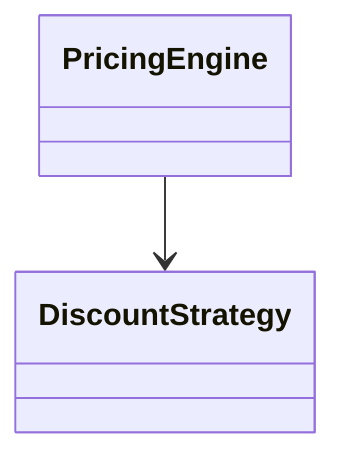

# LLD Prep

**Fourteen days to a low-level design interview, all offline.**

LLD Prep is a self-contained web app for experienced software engineers with a low-level design (LLD) or machine-coding round coming up in about two weeks. It replaces a pile of blog posts, GitHub repos and YouTube playlists with a single plan: about 4 focused hours a day, mixing lessons, coding exercises that are compiled and tested on your machine, step-by-step build-alongs, quizzes and timed mock interviews.

Every code example and exercise is available in **Java** and **Go**, written idiomatically in each language rather than translated from one to the other.

It assumes you already work as an engineer. It doesn't teach what a class or an interface is. It teaches what interviewers score, how to break a vague prompt down into entities in the first 10 minutes, which patterns are worth naming and when, and how to write correct, concurrency-safe code under time pressure.

---

## Contents

- [Quick start](#quick-start)
- [What you get](#what-you-get)
- [The 14-day plan](#the-14-day-plan)
- [How to use it well](#how-to-use-it-well)
- [Exercise catalog](#exercise-catalog)
- [Mock interviews and the rubric](#mock-interviews-and-the-rubric)
- [Command-line options](#command-line-options)
- [Your data](#your-data)
- [Hosting with Docker and Render](#hosting-with-docker-and-render)
- [How it works](#how-it-works)
- [Project layout](#project-layout)
- [Authoring content](#authoring-content)
- [Troubleshooting](#troubleshooting)

---

## Quick start

**Requirements**

| Tool | Version | Used for |
|---|---|---|
| Go | 1.23+ | running the server and Go exercises |
| JDK | 17+ (`javac` and `java` on `PATH`) | Java exercises |
| A modern browser | Chrome, Firefox, Safari or Edge | the UI |

You can do the course with only one of the two languages installed. The settings page shows which toolchains were found.

**Run**

```bash
git clone <this repo> lldprep && cd lldprep
go run .
```

The server starts on `http://127.0.0.1:8080` and opens your browser.

**Or build a single binary**

```bash
go build -o lldprep .
./lldprep
```

The binary embeds the whole UI and every lesson, exercise and quiz, so you can copy it to another machine (one with a JDK and/or Go) and run it there.

After the first run, nothing needs the network: no CDN, no telemetry, no accounts.

---

## What you get

| | Count | What it is |
|---|---|---|
| **Daily plan** | 14 days | A fixed agenda for each day of about 195–240 minutes. The dashboard shows today's items, a *Continue* button and your overall progress. |
| **Lessons** | 24 | Dense, interview-focused reading with Mermaid class and sequence diagrams, plus code that switches between Java and Go. |
| **Coding exercises** | 31 | A Monaco editor (the editor from VS Code), *Run* to see your program's output, *Run tests* to see a pass/fail result and message for each hidden test, hints revealed one at a time, and a reference solution you can reveal once you've tried. |
| **Build-alongs** | 2 | Parking Lot (6 steps) and Splitwise (5 steps). Each step explains one design decision, and you unlock the next step by passing its tests. |
| **Quizzes** | 8 | Scenario-based multiple-choice questions with an explanation for every answer. The pass mark is 70%. |
| **Timed mocks** | 6 | A countdown clock with hints hidden. When you finish, hidden tests run automatically and you score yourself on an interviewer rubric. Attempts are kept in a history. |
| **Search** | | Full-text search across lessons, exercises, tutorials and quizzes, with snippets. Press <kbd>⌘/Ctrl K</kbd> or <kbd>/</kbd>. |
| **Bookmarks** | | Bookmark whole pages or individual lesson sections (hover a heading and click its marker). |
| **Progress** | | Progress is tracked per item and per day. Code drafts autosave, and progress can be exported and imported as JSON. |
| **Themes** | | Light and dark themes that follow your OS, or you can pick one. The layout works on a phone for reading. |

**Keyboard shortcuts**

| Keys | Action |
|---|---|
| <kbd>⌘/Ctrl K</kbd> or <kbd>/</kbd> | Search |
| <kbd>⌘/Ctrl '</kbd> | Run your code (`main`) |
| <kbd>⌘/Ctrl Enter</kbd> | Run the tests (or check the current tutorial step) |

---

## The 14-day plan

| Day | Theme | Minutes |
|---|---|---|
| 1 | The interview playbook: how the round is scored, OOP and SOLID as interviewers see them, UML in 5 minutes | 230 |
| 2 | Strategy and the creational patterns (Factory, Builder, Singleton) | 215 |
| 3 | Observer, State and Command | 220 |
| 4 | Structural patterns (Decorator, Adapter, Facade, Composite, Proxy) and Chain of Responsibility | 235 |
| 5 | Concurrency for LLD: locks, lock ordering, holds with a time limit (TTL), blocking queues | 220 |
| 6 | Problem day: Parking Lot build-along and Tic-Tac-Toe | 195 |
| 7 | Games, chess and a review of week 1 | 225 |
| 8 | Elevators, rate limiters and pub-sub | 230 |
| 9 | Money: Splitwise build-along, ledgers, wallets, idempotency | 230 |
| 10 | Booking systems: BookMyShow, seat holds, library management | 210 |
| 11 | Marketplaces: ride sharing, food delivery, a KV store with transactions | 225 |
| 12 | E-commerce, scheduling, follow-up questions and common mistakes | 210 |
| 13 | Mock day 1 | 240 |
| 14 | Mock day 2 and final review | 200 |

The plan is defined in `content/plan.json`. Week 1 builds the toolkit and week 2 applies it to the problems that come up most often, finishing under interview conditions. The plan is based on published LLD problem lists and on how the round runs at FAANG-style companies (a design discussion plus code) and at machine-coding companies (90 minutes of working code).

---

## How to use it well

1. **Do the days in order.** Later lessons assume the earlier vocabulary, and the order of the problems is deliberate.
2. **Write code before reading the reference.** The tests are the feedback loop. Reveal hints one at a time, and reveal the reference only when you're stuck or have finished, then compare designs, not just output.
3. **Pick one language for interviews and stay with it.** You can switch any exercise between Java and Go, but drilling in one language builds speed.
4. **Say your design out loud** during the build-alongs and mocks. The rubric rewards communication, and most of what gets candidates rejected happens before they write any code.
5. **Use the revision lessons** (days 7, 12 and 14) and the final cheat sheet the night before the interview.

---

## Exercise catalog

Every exercise has a problem statement, a starter, hidden tests and a reference solution in both languages. Many include concurrency tests (for example, 64 goroutines or threads trying to book the same seats) that only a correctly synchronised design passes.

**Pattern drills**

| Exercise | Pattern | Difficulty | Minutes |
|---|---|---|---|
| Pluggable Discounts | Strategy | easy | 30 |
| Untangle the Notification God-Class | SOLID | easy | 45 |
| Immutable HTTP Request | Builder / functional options | easy | 35 |
| Payment Processor Registry | Factory | easy | 35 |
| Fix the Racy Singleton | Singleton, thread safety | easy | 30 |
| Stock Price Alerts | Observer | easy | 40 |
| Vending Machine | State | medium | 60 |
| Text Editor with Undo/Redo | Command | medium | 40 |
| Retry, Rate-Limit & Log a Sender | Decorator | medium | 40 |
| Logging Framework | Chain of Responsibility + Strategy | medium | 45 |
| In-Memory File System | Composite | medium | 45 |

**Concurrency building blocks**

| Exercise | Difficulty | Minutes |
|---|---|---|
| Closable Bounded Blocking Queue | medium | 45 |
| Seat Holds Without Double-Booking | medium | 50 |
| Thread-Safe LRU Cache | medium | 50 |

**Classic interview problems**

| Exercise | Difficulty | Minutes |
|---|---|---|
| Tic-Tac-Toe on an N×N Board | easy | 45 |
| Snake & Ladder | medium | 60 |
| Chess: Polymorphic Move Generation | hard | 75 |
| Elevator System (LOOK + dispatch strategy) | hard | 90 |
| Rate Limiter: three algorithms, one interface | medium | 50 |
| Pub-Sub Broker with Consumer Groups | medium | 60 |
| Digital Wallet: transfers, idempotency, no deadlocks | hard | 60 |
| Movie Ticket Booking (BookMyShow) | hard | 90 |
| Library Management System | medium | 60 |
| Ride Sharing: matching, trip lifecycle and fares | hard | 75 |
| In-Memory KV Store with Nested Transactions | hard | 60 |
| E-commerce Orders & Inventory Reservation | hard | 75 |
| Meeting Room Scheduler | medium | 60 |

**Build-alongs:** Parking Lot (6 steps) and Splitwise (5 steps).

**Mock problems:** Car Rental, Hotel Reservation, Task Board (Jira-lite) and Online Auction (eBay-lite). The two re-do mocks reuse Elevator and Movie Booking under time pressure.

---

## Mock interviews and the rubric

A mock starts with a prompt and a countdown (60–75 minutes). Hints and references are hidden. When you click *Finish interview*, or the clock runs out:

1. The hidden tests run against your code.
2. You score yourself from 0 to 3 on each criterion below, with a description of each level to keep you honest.
3. The weighted score, the test result and the time you took are saved to your mock history.

| Criterion | Weight |
|---|---|
| Requirements & scoping | 15% |
| Entities & relationships | 20% |
| Patterns & SOLID applied with reason | 15% |
| Working, readable code | 25% |
| Edge cases, errors & concurrency | 15% |
| Communication & extensibility | 10% |

The rubric is defined in `content/rubric.json`, and the mocks in `content/mocks/mocks.json`.

---

## Command-line options

```bash
go run . [flags]
```

| Flag | Default | Meaning |
|---|---|---|
| `-addr` | `127.0.0.1:8080` | Address to listen on. |
| `-data` | `data` | Folder for progress (`progress.json`) and code drafts (`drafts/`). |
| `-no-open` | off | Don't open the browser on start. |
| `-password` | `$LLDPREP_PASSWORD` | Require this password (HTTP basic auth, any username). Use it whenever the app is reachable from other machines. |
| `-dev` | off | Serve `web/` and `content/` from disk and reload content on every request, for editing. |
| `-verify` | off | Content check: run every reference solution against its tests in both languages, then exit. |
| `-only` | | With `-verify`, check only units whose id contains this string. |

If `$PORT` is set and `-addr` isn't passed, the app listens on `0.0.0.0:$PORT` and doesn't open a browser. This is what hosting platforms like Render expect.

Examples:

```bash
go run . -addr 127.0.0.1:9000 -data ~/lldprep-progress
go run . -verify -only booking
```

---

## Your data

- **No database, no browser storage, no network.** All state is plain files under `-data` (`./data` by default):
  - `data/progress.json`: completed items, quiz scores, bookmarks, mock history and settings.
  - `data/drafts/*.txt`: your autosaved code, one file per exercise, language and step.
- **Back up or move your progress** with *Settings → Export progress* / *Import progress*, or by copying the `data/` folder.
- **Start over** with *Settings → Reset progress*, which clears progress, scores, bookmarks and mock history but keeps your code drafts. To wipe everything, delete `data/`.
- `data/` is in `.gitignore`.

---

## Hosting with Docker and Render

The repo includes a `Dockerfile` (the server, Go 1.23 and JDK 17 in one image), `docker-entrypoint.sh` and a Render Blueprint (`render.yaml`).

> **Always set a password when hosting.** The app compiles and runs whatever code it receives. Without `LLDPREP_PASSWORD`, anyone who finds the URL can run code on your server. The app is also single-user: everyone who logs in shares one set of progress.

### Run the container locally

```bash
docker build -t lldprep .
docker run --rm -p 8080:8080 -e LLDPREP_PASSWORD=change-me -v lldprep-data:/data lldprep
# open http://127.0.0.1:8080 (any username, the password above)
```

Progress is stored in `/data` inside the container. The `-v lldprep-data:/data` volume keeps it between runs. User code runs as an unprivileged `app` user, not root.

### Deploy on Render

1. Push this repo to GitHub or GitLab.
2. In Render, choose **New → Blueprint** and select the repo. Render reads `render.yaml` and creates:
   - a **Docker web service** with a health check on `/healthz` (the only path that doesn't need the password),
   - a **1 GB persistent disk** mounted at `/data`, which holds your progress and drafts.
3. When prompted, enter a value for **`LLDPREP_PASSWORD`**.
4. Open the `https://<name>.onrender.com` URL and sign in with any username and that password.

**Plan and resources:**
- A persistent disk requires a paid instance, so the Blueprint uses the `starter` plan. On the free plan, remove the `disk:` block from `render.yaml`. The app works, but your progress is lost whenever the service restarts or spins down. Use *Settings → Export progress* regularly if you do this.
- The app needs about 512 MB of memory. Running Java (`javac` plus a JVM) is the heaviest part.

To deploy without the Blueprint, create a **Web Service** from the repo with **Runtime: Docker**, add the `LLDPREP_PASSWORD` environment variable, set the health check path to `/healthz`, and attach a disk at `/data`. Render's `$PORT` is picked up automatically.

---

## How it works

```
 Browser (Preact + Monaco)  ──HTTP/JSON──▶  Go server (single binary)
                                              ├─ content/  (embedded: lessons, exercises, quizzes, plan)
                                              ├─ web/      (embedded: UI and vendored libraries)
                                              ├─ data/     (your progress and drafts, plain files)
                                              └─ runner ──▶ javac/java  or  go test   (temp dir per run)
```

- **Server:** Go standard library only. `//go:embed` bundles `web/` and `content/` into the binary.
- **Code runner:** each run copies your code, the hidden tests and a small harness into a fresh temporary directory:
  - **Java:** compiled with `javac` and run by a reflection-based test runner (`internal/runner/assets/TestRunner.java`) that reports each test's result separately, with an 8 s timeout per test.
  - **Go:** run with `go test -json`, with `GOPROXY=off` and a guard file injected so that a panic fails only one test, not the whole suite.
  - Every run has a hard timeout, and the whole process group is killed when it expires, so an infinite loop can't hang the app.
- **Frontend:** no build step and no npm. Preact, htm, marked, Mermaid and Monaco are vendored in `web/vendor/` and loaded through an import map.
- **Content** is plain Markdown and JSON on disk, so you can read it, diff it and edit it without the app.

> **Security note:** the server runs whatever code you type, with your user's permissions. It listens on `127.0.0.1` only by default. If you expose it, set a password (see [Hosting](#hosting-with-docker-and-render)).

**HTTP API** (used by the UI)

| Method & path | Purpose |
|---|---|
| `GET /api/plan` | Days, mocks, rubric and the content catalog |
| `GET /api/lesson/{id}` · `/api/exercise/{id}` · `/api/tutorial/{id}` · `/api/quiz/{id}` | Content |
| `GET /api/solution/{kind}/{id}/{lang}` | Reference solution |
| `GET /api/search?q=` | Full-text search |
| `GET /api/toolchains` | Detected JDK and Go versions |
| `GET` / `PUT /api/state` | Read and write progress |
| `GET` / `PUT` / `DELETE /api/draft/{key}` | Code drafts |
| `POST /api/run` | Compile and run code: `{kind, id, lang, mode: "run" \| "test", code, step}` |

---

## Project layout

```
.
├── main.go                    server, routes, -verify
├── go.mod                     module lldprep (stdlib only)
├── Dockerfile, docker-entrypoint.sh, render.yaml   hosting
├── internal/
│   ├── content/content.go     loads the plan, lessons, exercises, tutorials, quizzes, mocks; search
│   ├── runner/                compile/run/test for Java and Go, timeouts, process cleanup
│   │   └── assets/            TestRunner.java, Go panic guard
│   └── store/store.go         atomic JSON and draft files under data/
├── web/
│   ├── index.html, styles.css
│   ├── js/                    app shell, lessons, workbench, quiz, mock, editor, markdown
│   └── vendor/                preact, htm, marked, mermaid, monaco (pinned, offline)
└── content/
    ├── plan.json              the 14-day agenda
    ├── rubric.json            mock scoring criteria
    ├── lessons/*.md           24 lessons
    ├── exercises/<id>/        31 exercises (Java and Go each)
    ├── tutorials/<id>/        build-alongs with per-step tests
    ├── quizzes/*.json         8 quizzes
    └── mocks/mocks.json       6 timed mocks
```

---

## Authoring content

Run with `-dev` while editing. Content then reloads from disk on every request, so you only need to refresh the browser.

```bash
go run . -dev
```

### Lessons: `content/lessons/<id>.md`

````markdown
---
title: Pattern: Strategy
summary: One line shown in lists and search.
---

## A section heading        (h2 and h3 headings can be bookmarked)



```java
interface DiscountStrategy { long apply(long cents); }
```
```go
type DiscountStrategy interface{ Apply(cents int64) int64 }
```
````

- A `java` fence immediately followed by a `go` fence is shown as one block with a language toggle.
- A `mermaid` fence is rendered as a diagram.
- `<div class="lang-note" data-lang="go">…</div>` is shown only when that language is selected.

### Exercises: `content/exercises/<id>/`

```
exercise.json          title, difficulty, summary, minutes, tags, hints[]
problem.md             the problem statement
java/Solution.java     starter (what the learner edits; must compile)
java/Reference.java    reference solution (same class names as the starter)
java/Main.java         demo driver for "Run"
java/Tests.java        static methods named test*, using T.eq / T.check / T.throwsEx
go/solution.go         starter (package main; must compile)
go/reference.go.txt    reference solution (.txt so the Go toolchain ignores it)
go/main.go             demo driver
go/solution_test.go    standard Go tests; start each with `defer guard(t)`
```

### Tutorials: `content/tutorials/<id>/`

These use the exercise layout plus `tutorial.json` (the step list), `intro.md` and `steps/N.md`. Test names carry their step number: `s1_…` in Java and `TestS1_…` in Go. *Check step N* runs the tests for steps 1 through N.

### Quizzes, the plan and mocks

- `content/quizzes/<id>.json`: `{ title, questions: [{ q, options[], answer, explain }] }`, where `answer` is the index of the correct option.
- `content/plan.json`: each day lists its items by kind and id, with a time estimate in minutes.
- `content/mocks/mocks.json`: a mock points to an exercise and sets its time limit.

### Check before you commit

```bash
go run . -verify
```

This checks that, in both languages:
- every reference solution passes all of its tests,
- every `main` runs,
- every starter compiles but **does not** pass (so learners have something to do).

> Build and vet the server with `go build .` and `go vet . ./internal/...`. Don't use `./...`, which would also try to compile the exercise starters under `content/`.

---

## Troubleshooting

| Symptom | Fix |
|---|---|
| Settings shows *Java: not found*, or a run says *Toolchain missing* | Install JDK 17+ and make sure `javac -version` works in the shell that starts the server. |
| Settings shows *Go: not found* | Make sure `go version` works in the same shell. |
| Port already in use | Run `go run . -addr 127.0.0.1:8081`. |
| The browser doesn't open | Open `http://127.0.0.1:8080` yourself, or pass `-no-open` to stop the server trying. |
| The first Go test run is slow | Go is building its test cache. Later runs are faster. |
| A run shows *Timed out* | Look for an infinite loop or a deadlock. Every run has a hard limit, and the process is killed when it runs out. |
| The UI looks stale after editing files | Run with `-dev` and hard-refresh the browser. |
