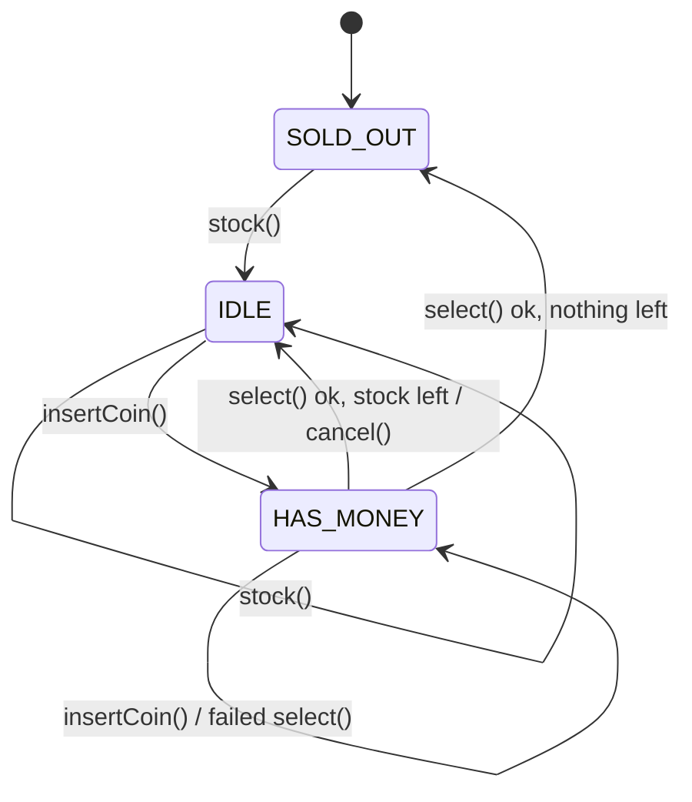

Design a vending machine. This exact problem is asked at Amazon, Flipkart and Microsoft, and the interviewer wants to see **explicit states**, not a nest of `if` statements.

## Behaviour

Accepted coins (cents): **5, 10, 25, 100**. Any other value is rejected in every state.

| Operation | SOLD_OUT | IDLE | HAS_MONEY |
|---|---|---|---|
| `stock(product, qty)` | add stock → IDLE | add stock | **error: busy** |
| `insertCoin(c)` | **error: sold out** | balance += c → HAS_MONEY | balance += c |
| `select(code)` | **error: sold out** | **error: insert money first** | see below |
| `cancel()` | returns 0 | returns 0 | returns balance → IDLE |

`select(code)` in HAS_MONEY:

- unknown code → **error: unknown product**
- that product has 0 units → **error: out of stock**
- balance < price → **error: insufficient funds**
- otherwise: one unit is dispensed, the result is `Dispense(product, change = balance − price)`, the balance resets to 0, and the state becomes **SOLD_OUT** if total stock is now 0, else **IDLE**

A failed `select` changes nothing. `stock()` with a code that already exists adds to its quantity (price and name come from the latest call). `state()` returns `"SOLD_OUT"`, `"IDLE"` or `"HAS_MONEY"`. A new machine is `SOLD_OUT`.

Errors: an invalid coin, unknown product or `qty <= 0` throws `IllegalArgumentException`. Every other error above throws `IllegalStateException`.

Errors: `ErrInvalidCoin`, `ErrInvalidQuantity`, `ErrBusy`, `ErrSoldOut`, `ErrInsertMoneyFirst`, `ErrUnknownProduct`, `ErrOutOfStock`, `ErrInsufficientFunds`.

## Follow-ups you may get

- *"Return change using the fewest coins, with a limited coin inventory."* (A greedy change-maker. Where does it live?)
- *"Add a MAINTENANCE state."* (One new class. Which existing code changes?)
- *"Two users press buttons at once."* (Synchronise the machine's public methods. It's one physical device.)
