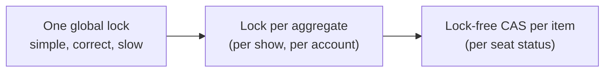

Almost every LLD problem has one concurrency question hiding in it: **two users want the same seat, slot, driver, spot, or the last item**. Interviewers want three things:

1. You **spot** the shared mutable state without being prompted.
2. You protect it with the **right primitive at the right granularity**.
3. You can explain why your solution can't **double-book** or **deadlock**.

## Step 1: find the shared mutable state

Ask: *what data is read and written by more than one request at the same time?*

| Problem | Shared state | Invariant |
|---|---|---|
| Movie booking | seat status per show | a seat is held or booked by at most one user |
| Parking lot | free spots per type | a spot holds at most one vehicle |
| Ride sharing | driver availability | a driver is assigned to at most one trip |
| Wallet | account balances | balance ≥ 0, and money is conserved |
| Rate limiter | counters per key | no more than N per window |
| Inventory | stock per SKU | stock ≥ 0 |
| Cache | the map plus eviction order | size ≤ capacity, LRU order is consistent |

Immutable objects (value objects, configuration) need no protection. Say so. It shows you know *where* to stop.

## Step 2: pick the primitive

### Java toolbox

| Need | Use |
|---|---|
| Guard a small critical section | `synchronized` method or block, or `ReentrantLock` (supports `tryLock` with a timeout, and fairness) |
| Many readers, few writers | `ReentrantReadWriteLock` |
| A single counter or reference | `AtomicLong`, `AtomicReference`, `LongAdder`, with `compareAndSet` |
| A concurrent map | `ConcurrentHashMap`: `computeIfAbsent`, `merge` and `compute` are **atomic per key** |
| Producer/consumer | `BlockingQueue` (`ArrayBlockingQueue`, `LinkedBlockingQueue`) |
| Wait for a condition | `lock.newCondition()` with `await`/`signalAll` (or `wait`/`notifyAll`) |
| Limit concurrency | `Semaphore` |
| Run work | `ExecutorService`, `CompletableFuture` |

### Go toolbox

| Need | Use |
|---|---|
| Guard a critical section | `sync.Mutex` (keep the `Lock` and `defer Unlock` pair short) |
| Many readers | `sync.RWMutex` |
| Counters and flags | `sync/atomic` (`atomic.Int64`, `atomic.Bool`, `CompareAndSwap`) |
| One-time init | `sync.Once` |
| Producer/consumer, ownership hand-off | **channels** (a buffered channel *is* a bounded blocking queue) |
| Wait for a condition | `sync.Cond`, or better, a channel |
| Fan-out and wait | `sync.WaitGroup`, `errgroup` |
| Concurrent map | `map` + `Mutex` (preferred), or `sync.Map` for append-mostly caches |

### Python toolbox

| Need | Use |
|---|---|
| Guard a critical section | `threading.Lock` (or `RLock` if the same thread re-enters), always as `with lock:` |
| Many readers, few writers | No read-write lock in the standard library: use one `Lock` and keep it short |
| Counters | There's no atomic integer. `+=` is a read-modify-write, so protect it with a lock |
| One-time init | A module-level object (modules are imported once), or double-checked locking with a `Lock` |
| Producer/consumer | `queue.Queue(maxsize=n)` is a bounded blocking queue (`put`/`get`, with timeouts) |
| Wait for a condition | `threading.Condition` with `wait`/`notify_all`, or `threading.Event` for a one-shot signal |
| Start together, then wait | `threading.Barrier`, `Thread.join`, `concurrent.futures.ThreadPoolExecutor` |
| Limit concurrency | `threading.Semaphore` / `BoundedSemaphore` |

<div class="lang-note" data-lang="python">

**The GIL doesn't make your code thread-safe.** CPython runs one thread's bytecode at a time, but it can switch threads between any two bytecodes. `if seat.free: seat.book()` and `self.count += 1` are each several bytecodes, so both can interleave. Single operations on built-in containers (`dict[k] = v`, `list.append`) happen to be atomic in CPython, but don't rely on that in an interview. Say *"I protect the invariant with a lock"* instead. (For CPU-bound work, the GIL is why you'd reach for processes, but LLD interviews are about correctness, not throughput.)

</div>

> **Go proverb:** *"Don't communicate by sharing memory; share memory by communicating."* For some components (a single elevator controller, a matching engine), the cleanest Go design is **one goroutine that owns the state**, receiving requests on a channel, with no locks at all. Mention it as an alternative.

## Step 3: choose the granularity



Start with the **simplest correct** option and state the trade-off. *"One lock per Show: bookings for different shows never contend. If a single show is hot, I'd go to per-seat CAS."*

## The double-booking problem (asked constantly)

Check-then-act is the bug:

```java
// ✗ RACE: two threads both see AVAILABLE, both book
if (seat.status() == AVAILABLE) { seat.setStatus(BOOKED); }
```

```python
# ✗ RACE: two threads both see AVAILABLE, both book (the GIL can switch between these two lines)
if seat.status is Status.AVAILABLE:
    seat.status = Status.BOOKED
```

There are three correct fixes. Know all three.

```java
// ✓ 1. Lock the aggregate: atomic check + act for multi-seat bookings
synchronized (show) {
    for (Seat s : seats) if (s.status() != AVAILABLE) throw new SeatUnavailableException(s);
    for (Seat s : seats) s.hold(userId, now + ttl);
}

// ✓ 2. CAS per seat: lock-free, but multi-seat needs a rollback on partial failure
if (!seat.status.compareAndSet(AVAILABLE, HELD)) throw new SeatUnavailableException(seat);

// ✓ 3. Database: unique constraint on (show_id, seat_id) in bookings,
//      or UPDATE seats SET status='HELD' WHERE id=? AND status='AVAILABLE' and check rows updated == 1
```

```go
// ✓ Lock per show
func (s *Show) Hold(seatIDs []string, user string, now time.Time) error {
	s.mu.Lock()
	defer s.mu.Unlock()
	for _, id := range seatIDs {
		if !s.seats[id].availableAt(now) {
			return fmt.Errorf("%w: %s", ErrSeatUnavailable, id)
		}
	}
	for _, id := range seatIDs {
		s.seats[id].hold(user, now.Add(s.holdTTL))
	}
	return nil
}
```

```python
# ✓ Lock per show: the check and the act happen inside one critical section
def hold(self, seat_ids: List[str], user: str, now: int) -> None:
    with self._lock:
        for sid in seat_ids:  # validate all...
            if not self._seats[sid].available_at(now):
                raise SeatUnavailableError(sid)
        for sid in seat_ids:  # ...then mutate all
            self._seats[sid].hold(user, now + self._hold_ttl)
```

**All-or-nothing:** when booking several seats, validate *all* of them under the lock **before** changing any.

**Holds with a TTL:** a seat held during payment expires after N minutes. Model it with an `expiresAt` timestamp checked **lazily**: a seat is available if it's `AVAILABLE`, or `HELD` and the hold has expired. This avoids background timers, and it's deterministic and testable with an injected clock.

## Deadlock: the four conditions and the standard fix

A deadlock needs **all four**: mutual exclusion, hold-and-wait, no preemption, and **circular wait**. Break the circular wait with a **global lock order**:

```java
// Transfer between two accounts: always lock the lower id first
void transfer(Account a, Account b, long amt) {
    Account first = a.id() < b.id() ? a : b, second = first == a ? b : a;
    synchronized (first) { synchronized (second) { a.debit(amt); b.credit(amt); } }
}
```

```python
# Transfer between two accounts: always lock the lower id first
def transfer(a: Account, b: Account, amount: int) -> None:
    first, second = sorted((a, b), key=lambda acc: acc.id)
    with first.lock, second.lock:
        a.debit(amount)
        b.credit(amount)
```

Other answers: `tryLock` with a timeout and retry, or a single lock if contention is low.

## Bounded blocking queue (classic warm-up)

```java
final class BoundedQueue<T> {
    private final Deque<T> items = new ArrayDeque<>();
    private final int cap;
    private final ReentrantLock lock = new ReentrantLock();
    private final Condition notFull = lock.newCondition(), notEmpty = lock.newCondition();

    BoundedQueue(int cap) { this.cap = cap; }

    void put(T x) throws InterruptedException {
        lock.lock();
        try {
            while (items.size() == cap) notFull.await();   // while, not if: spurious wakeups
            items.addLast(x);
            notEmpty.signal();
        } finally { lock.unlock(); }
    }

    T take() throws InterruptedException {
        lock.lock();
        try {
            while (items.isEmpty()) notEmpty.await();
            T x = items.removeFirst();
            notFull.signal();
            return x;
        } finally { lock.unlock(); }
    }
}
```

```python
class BoundedQueue:
    def __init__(self, cap: int) -> None:
        self._items: Deque = deque()
        self._cap = cap
        lock = threading.Lock()
        self._not_full = threading.Condition(lock)  # two conditions sharing one lock
        self._not_empty = threading.Condition(lock)

    def put(self, x) -> None:
        with self._not_full:
            while len(self._items) == self._cap:  # while, not if: spurious wakeups
                self._not_full.wait()
            self._items.append(x)
            self._not_empty.notify()

    def take(self):
        with self._not_empty:
            while not self._items:
                self._not_empty.wait()
            x = self._items.popleft()
            self._not_full.notify()
            return x
```

In Go it's a buffered channel: `q := make(chan T, cap)`, with `q <- x` and `<-q`. In Python it's `queue.Queue(maxsize=cap)`. Interviewers sometimes ask you to build it **without** those, using `sync.Cond` or `threading.Condition`, to check that you understand the mechanics.

## Thread-safety checklist for your LLD answers

- [ ] Named the shared state and the invariant
- [ ] Check-then-act sequences happen **inside** the same critical section
- [ ] Multi-resource operations are all-or-nothing
- [ ] Locks taken in a consistent order. No calls to external code (observers, callbacks, I/O) while holding a lock
- [ ] Time comes from an injected clock, so expiry logic is testable
- [ ] Mentioned how this maps to a database (unique constraints, optimistic locking with a `version` column) once there are several service instances
