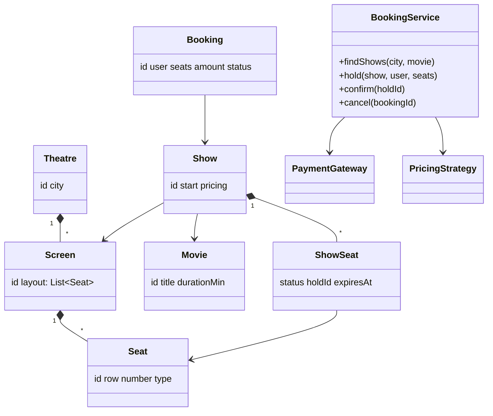
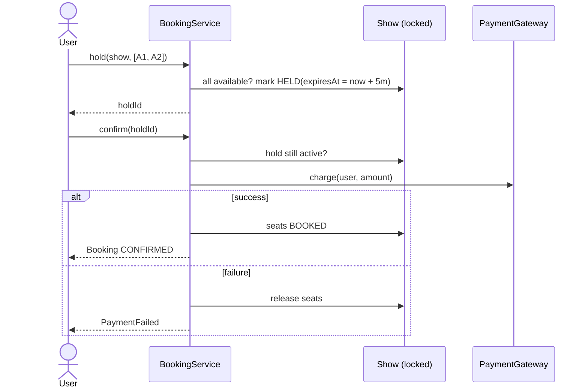

## Requirements

1. Theatres in cities have screens. Screens have a fixed **seat layout** with seat types (regular, premium).
2. Admins add movies and schedule **shows** (movie + screen + start time). Shows on one screen can't overlap.
3. Users search shows by **city and movie**.
4. A user picks seats. The seats are **held** for a few minutes while the user **pays**.
5. Payment success confirms the booking. Failure or a timeout releases the seats.
6. Users can **cancel** before the show starts.
7. **No double booking**, ever, under concurrent users.

## Catalogue vs inventory

This is the key modelling insight. Say it explicitly:

| Static catalogue (rarely changes) | Per-show inventory (changes every second) |
|---|---|
| `Movie`, `Theatre`, `Screen`, `Seat` (layout) | `Show`, `ShowSeat` (status per show), `Hold`, `Booking` |

A `Seat` is a physical chair, `A7` in screen 2. A `ShowSeat` is *that chair for the 7 pm show*, with its own status and price. Mixing the two is the most common mistake.

## Flow: hold → pay → confirm

**Where do you call the payment gateway?** Not inside the show's lock. A slow gateway would block every other user of that show. The robust pattern:

1. Under the lock, validate that the hold is active and **extend or mark it** as "payment in progress".
2. Call the gateway **outside** the lock.
3. Re-acquire the lock to apply the result (confirm or release).

For the interview exercise, a fast in-memory gateway inside the lock is acceptable. **Say** that in production you'd release the lock around the external call.

## Pricing

A `PricingStrategy` with `price(show, seat)`. The base is per seat type, and variations include weekend or prime-time multipliers, dynamic pricing based on occupancy, and coupons (a Decorator on the price). Keep it an interface.

## Show scheduling: interval overlap

Two shows on the same screen overlap if `startA < endB && startB < endA`. Keep the shows per screen and check them on insert. Adding cleaning buffers between shows is a common follow-up: `end = start + duration + buffer`.

## Concurrency recap

- **Lock per show.** Different shows never contend.
- All-or-nothing holds (validate every seat, then mark).
- Lazy expiry with an injected clock.
- With multiple servers: a conditional `UPDATE show_seats SET status='HELD' … WHERE status='AVAILABLE' OR expires_at <= now()`, checking the affected row count, inside one DB transaction.

## Follow-ups

| Question | Answer |
|---|---|
| Waitlist when sold out | Observer on seat release, notifying the first in queue |
| Partial refunds on cancellation | a `RefundPolicy` strategy (100% if more than 24 h before, 50% if more than 2 h, otherwise 0) |
| Seat-selection rules (no single empty seat gaps) | a validator chain (Chain of Responsibility) run during `hold` |
| Notifications | an event (`BookingConfirmed`) published to a notification service |
| Many cities, huge scale | that's HLD: sharding by city or show, caching of the catalogue |
