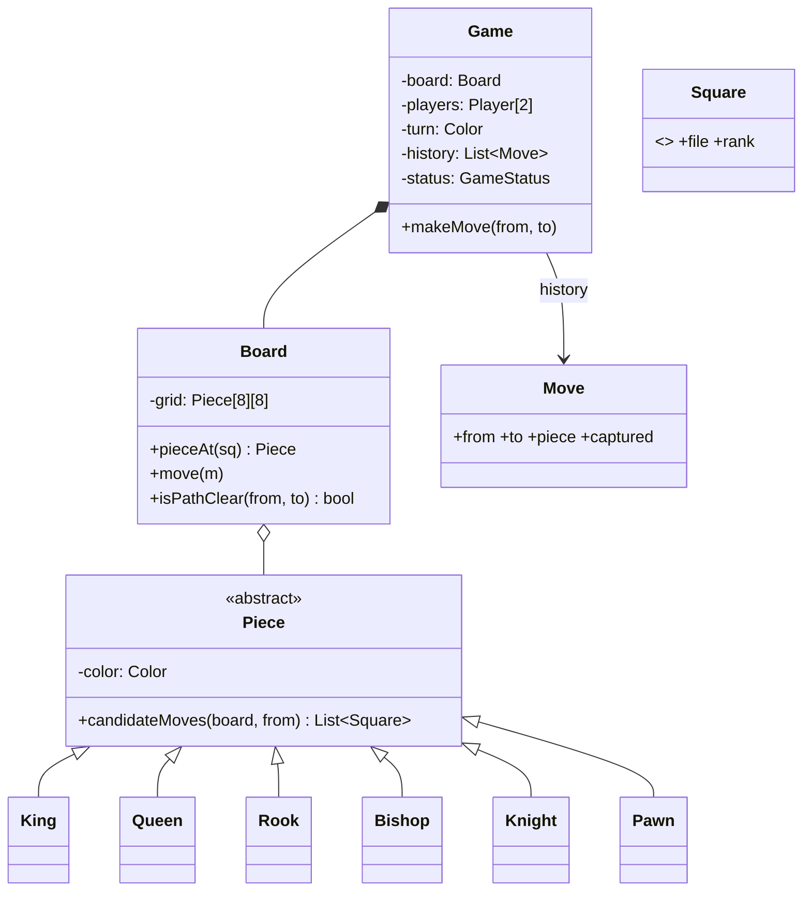

Chess is asked as an **OOD** problem, at Amazon and Microsoft especially. Nobody expects a full rules engine in 45 minutes. They expect a **clean model**, polymorphic move rules, and a clear story for check, castling and undo.

## Requirements to agree on

1. Two players, white moves first, and turns alternate.
2. Each piece type has its own movement rules. Pieces can't jump over others (except the knight), and a move can capture an opposing piece.
3. A move that leaves your own king in check is illegal.
4. Detect checkmate and stalemate to end the game.
5. **Out of scope by default:** en passant, castling, promotion (mention them as extensions), clocks, network play.

## Classes



Key decisions to **say out loud**:

- **`Square` is a value object** (`file 0–7`, `rank 0–7`, parsed from `"e4"`). It stops "row vs column" bugs everywhere.
- **Pieces know how they move; the board knows where things are.** `Piece.candidateMoves(board, from)` asks the board about occupancy but never mutates it.
- **Two-phase validation:** (1) the piece generates *pseudo-legal* moves (geometry, blocking, captures). (2) The game filters out moves that leave the mover's king in check, by simulating the move on a copy of the board, or by applying and undoing it.
- **The `Move` record** keeps the captured piece, which makes undo trivial (Command/Memento).

## Sliding pieces: share the ray logic

Rook, bishop and queen differ only in their **directions**. Put the ray walk in one helper. Interviewers like seeing this kind of duplication removed.

```java
abstract class Piece {
    final Color color;
    abstract List<Square> candidateMoves(Board b, Square from);

    protected List<Square> slide(Board b, Square from, int[][] dirs) {
        List<Square> out = new ArrayList<>();
        for (int[] d : dirs) {
            Square s = from.offset(d[0], d[1]);
            while (s != null) {                          // null = off the board
                Piece p = b.pieceAt(s);
                if (p == null) out.add(s);
                else { if (p.color != color) out.add(s); break; }   // capture, then stop
                s = s.offset(d[0], d[1]);
            }
        }
        return out;
    }
}

final class Rook extends Piece {
    static final int[][] DIRS = {{1,0},{-1,0},{0,1},{0,-1}};
    List<Square> candidateMoves(Board b, Square from) { return slide(b, from, DIRS); }
}
```

```go
type Piece interface {
	Color() Color
	Kind() Kind
	CandidateMoves(b *Board, from Square) []Square
}

// In Go, one struct can describe every slider by its directions.
type slider struct {
	color Color
	kind  Kind
	dirs  [][2]int
	max   int // 1 for king steps, 7 for sliders
}

func (p slider) CandidateMoves(b *Board, from Square) []Square {
	var out []Square
	for _, d := range p.dirs {
		s := from
		for i := 0; i < p.max; i++ {
			var ok bool
			if s, ok = s.Offset(d[0], d[1]); !ok {
				break
			}
			if q := b.At(s); q == nil {
				out = append(out, s)
			} else {
				if q.Color() != p.color {
					out = append(out, s)
				}
				break
			}
		}
	}
	return out
}
```

```python
class Piece(ABC):
    def __init__(self, color: Color) -> None:
        self.color = color

    @abstractmethod
    def candidate_moves(self, board: Board, src: Square) -> List[Square]: ...

    def _slide(self, board: Board, src: Square, dirs) -> List[Square]:
        out = []
        for df, dr in dirs:
            sq = src.offset(df, dr)
            while sq is not None:  # None = off the board
                other = board.piece_at(sq)
                if other is None:
                    out.append(sq)
                else:
                    if other.color is not self.color:
                        out.append(sq)  # capture, then stop
                    break
                sq = sq.offset(df, dr)
        return out


class Rook(Piece):
    DIRS = ((1, 0), (-1, 0), (0, 1), (0, -1))

    def candidate_moves(self, board, src):
        return self._slide(board, src, self.DIRS)
```

**King** = the queen's directions with a range of 1. **Knight** = 8 fixed offsets with no blocking. **Pawn** is the odd one out: it moves forward without capturing, captures diagonally, has a double step from its start rank, and its direction depends on colour.

## Check, checkmate, stalemate

```text
inCheck(color)      = some opposing piece's candidate moves include color's king square
legalMoves(color)   = for each pseudo-legal move: apply on a copy; keep it if !inCheck(color)
after a move:
   opponent has no legal moves and is in check   → CHECKMATE
   opponent has no legal moves and not in check  → STALEMATE
```

That's O(pieces × moves) per check, which is fine for an interview. Mention bitboards if they push on performance.

## Follow-ups and where they plug in

| Follow-up | Where it goes |
|---|---|
| Castling | a special move generated by `King`, needing `hasMoved` flags on the king and rook plus "squares not attacked" checks |
| En passant | the game remembers the last move. `Pawn` asks for it via a game-state parameter |
| Promotion | `Move` gets an optional `promotionKind`, and the board swaps the pawn when the move is applied |
| Undo | pop the last `Move` from history and restore `piece` and `captured` (that's why `Move` stores both) |
| Chess variants / custom pieces | a new `Piece` subclass, or a data-driven `slider` with new directions |
| Timers | a `Clock` per player, ticked by the game on every move (inject it for tests) |
| Online play | `Game` stays pure. A `GameSession` service handles players and persistence (that's HLD) |

The exercise after this lesson makes you implement the pseudo-legal move generator and turn handling, which is exactly the part interviewers ask candidates to code.
