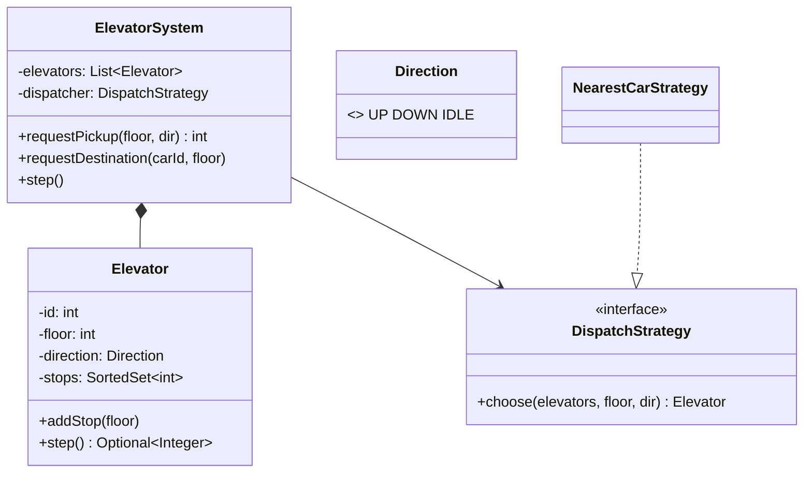

The elevator is the classic "behaviour over time" problem. Candidates who only draw classes struggle. Candidates who model **requests, per-car scheduling and a dispatcher** do well.

## Requirements

1. A building with `F` floors and `E` elevators.
2. **Hall call:** someone on floor 7 presses ▲ or ▼. The system assigns *one* elevator.
3. **Car call:** someone inside elevator 2 presses 12. That elevator adds a stop.
4. Each elevator serves its stops efficiently, without bouncing back and forth.
5. Swappable **dispatch** strategy (which car answers a hall call).
6. Out of scope: weight limits, door timing, emergency modes (mention them as states).

## Core model



The system is a **Mediator**: hall buttons never talk to cars directly. Dispatching is a **Strategy**. Each car's movement is a small **state machine** (`IDLE`, `MOVING_UP`, `MOVING_DOWN`, plus `DOORS_OPEN` and `MAINTENANCE` as extensions).

## Make time explicit: `step()`

Real elevators run on timers. Code that sleeps is untestable. Model time as **discrete ticks**: each `step()` moves every car at most one floor and opens doors at stops. Tests call `step()` N times and assert positions. Production calls it from a scheduler every second.

**Say:** *"I'll model time as explicit ticks so the scheduling logic is deterministic and unit-testable. The real-time loop is a thin wrapper."*

## Per-car scheduling: LOOK

| Algorithm | Behaviour | Verdict |
|---|---|---|
| FCFS | serve requests in arrival order | lots of back-and-forth, so poor |
| SSTF | nearest stop next | can starve far floors |
| SCAN | sweep to the end of the shaft, then reverse | fair, but travels needlessly to the ends |
| **LOOK** | sweep while there are stops ahead, then reverse | **the standard answer** |

```java
Optional<Integer> step() {
    if (stops.isEmpty()) { direction = IDLE; return Optional.empty(); }
    if (stops.contains(floor)) { stops.remove(floor); return Optional.of(floor); }   // doors open here
    if (direction == IDLE) direction = nearestStop() > floor ? UP : DOWN;
    if (direction == UP && stops.ceiling(floor) == null) direction = DOWN;           // nothing ahead: reverse
    if (direction == DOWN && stops.floor(floor) == null) direction = UP;
    floor += direction == UP ? 1 : -1;
    if (stops.remove(floor)) return Optional.of(floor);
    return Optional.empty();
}
```

A `TreeSet` / sorted structure makes "is there a stop above me?" an O(log n) `ceiling` lookup. In Go, a small sorted slice or a `map[int]bool` scanned per step is fine at building scale.

## Dispatching hall calls

A good default cost function, often called **nearest car with direction awareness**:

```text
cost(car, floor, dir):
  if car is IDLE                                    → |car.floor − floor|
  if car is moving toward floor in the same dir     → |car.floor − floor|
  otherwise (must finish its sweep first)           → |car.floor − turnaround| + |turnaround − floor|
choose the car with the lowest cost, ties → lowest id
```

Other strategies to mention: zoning (cars 1–2 serve floors 0–20), least-loaded, and destination dispatch (passengers enter their floor in the lobby).

## Concurrency

Hall calls arrive from many threads, while the tick loop mutates the cars. There are two clean answers:

- **One lock** around the system's public methods and `step()`. Simple, and the operations are tiny.
- **Go:** one goroutine owns all the state and receives requests on a channel, with a ticker for steps. No locks at all.

## Follow-ups

| Follow-up | Answer |
|---|---|
| Capacity / weight | the car rejects new hall assignments while full, and the dispatcher skips it |
| VIP / fire mode | a state on the system that overrides dispatch (Strategy swap) and on cars (State) |
| Display panels in every lobby | Observer on car position changes |
| Minimise energy instead of wait time | a different cost function. Same interface |

The exercise that follows implements exactly this: LOOK per car, the nearest-car dispatcher, and deterministic ticks.
