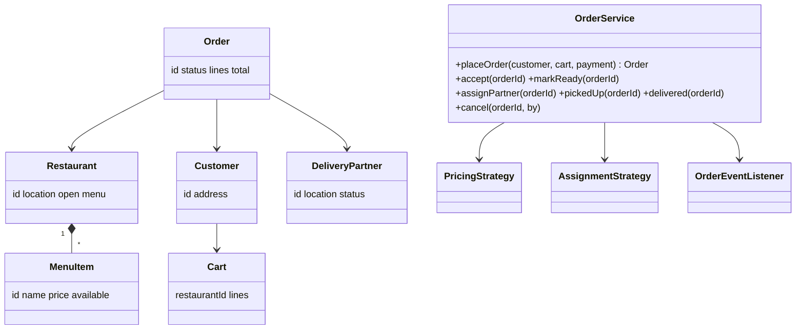
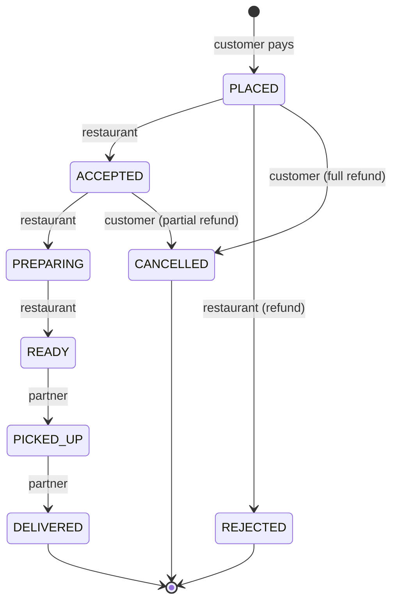

Food delivery is "ride sharing + e-commerce". If you can do those two, you can do this one. The interviewer is checking that you **reuse** patterns rather than reinventing them.

## Requirements

1. Customers browse restaurants near them, and restaurants have menus with item availability.
2. A cart holds items from **one restaurant only**. Adding an item from a different restaurant prompts the user to clear the cart.
3. Placing an order: validate the items are available, compute the price (items + delivery fee + taxes − coupon), and take payment.
4. The restaurant accepts or rejects, then prepares the food. A **delivery partner** is assigned, picks it up and delivers.
5. Live status updates to the customer.
6. Cancellation rules depend on the state.

## Three actors, one order



## Order state machine, with an owner per transition



Interviewers love asking **who is allowed to trigger each transition**. Make it part of the transition table: `(from, to) → allowedActor`. Wrong actor → `UnauthorizedException`.

## Reused building blocks

| Concern | Pattern you already built |
|---|---|
| Order lifecycle | State / transition table (vending machine, ride trips) |
| Partner assignment | Matching strategy (ride sharing): nearest available partner to the **restaurant** |
| Pricing (items, fees, surge, coupons) | Strategy + Decorator (discounts exercise) |
| Status updates to customer, restaurant and partner apps | Observer / pub-sub (`OrderEvent`) |
| Payment + refunds | Gateway interface + idempotency keys (wallet) |
| No double assignment of a partner | One lock or CAS (ride sharing) |
| Stock / "item unavailable" | Inventory check at placement, with atomic reservation |

**Say this table out loud.** It shows you can decompose a big system into known pieces, which is exactly the senior signal they're looking for.

## Cart rule (asked often)

```java
void add(String restaurantId, MenuItem item, int qty) {
    if (this.restaurantId != null && !this.restaurantId.equals(restaurantId))
        throw new DifferentRestaurantException(this.restaurantId);   // UI asks "clear cart?"
    this.restaurantId = restaurantId;
    lines.merge(item.id(), qty, Integer::sum);
}
```

```python
def add(self, restaurant_id: str, item: MenuItem, qty: int) -> None:
    if self.restaurant_id is not None and self.restaurant_id != restaurant_id:
        raise DifferentRestaurantError(self.restaurant_id)  # UI asks "clear cart?"
    self.restaurant_id = restaurant_id
    self.lines[item.id] = self.lines.get(item.id, 0) + qty
```

## When to assign the delivery partner

- **Assign on ACCEPTED** with an estimated prep time, so the partner arrives as the food is ready. This is the typical answer.
- Assign on READY instead: simpler, but delivery is slower.
- Re-assignment: if a partner declines or goes offline, return them to the pool and match again.

## Follow-ups

| Follow-up | Answer |
|---|---|
| Restaurant closes mid-order | an event triggers cancellation with a full refund |
| Batched deliveries (2 orders, 1 partner) | the assignment strategy considers route detours (mention a TSP heuristic) |
| ETA | prep time estimate + travel time. A strategy, so it's easy to make ML-based later |
| Ratings for food and delivery separately | two rating entities linked to the order |
| Scale | HLD territory: geo-sharded partner index, event streaming for status |
