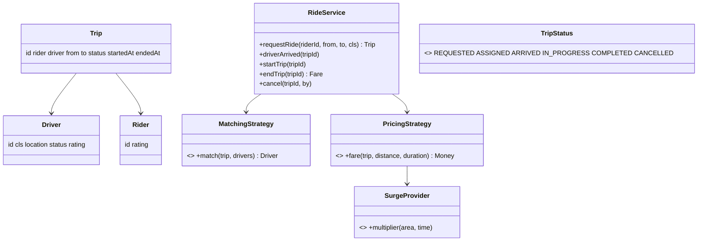
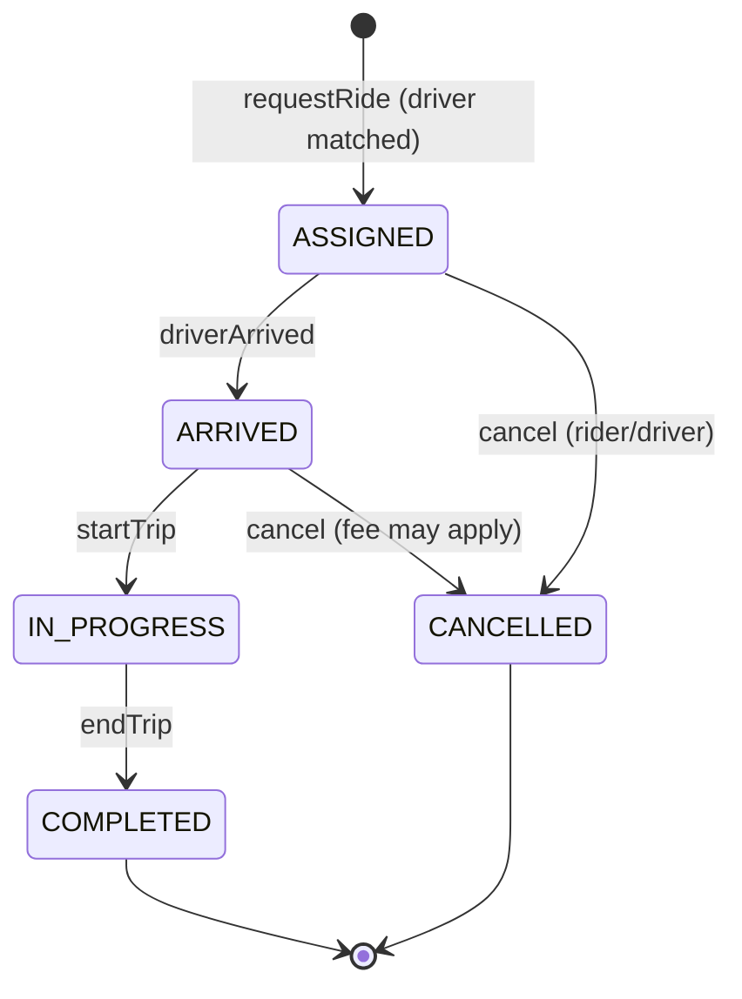

## Requirements

1. Drivers go online or offline and report their location.
2. A rider requests a ride from A to B with a vehicle class (Mini, Sedan, SUV).
3. The system **matches** a nearby available driver. The driver accepts (simplified: auto-accept).
4. Trip lifecycle: requested → driver assigned → driver arrived → in progress → completed, with cancellation allowed early on.
5. The **fare** is computed at the end: base + per-km + per-minute, times a **surge** multiplier.
6. Ratings after the trip.
7. **A driver can never be assigned to two trips at once.**

## Classes



## The trip state machine



The driver's own status mirrors it: `AVAILABLE` → `ON_TRIP` (from assignment until completion or cancellation) → `AVAILABLE`, plus `OFFLINE`.

## Matching (Strategy)

Default: **nearest available driver of the requested class** within a radius, with ties broken by rating and then by id. Alternatives to mention: highest rating, least idle time (fairness), ETA via a road graph, and batch matching (assign many requests at once to minimise total pickup time).

Distance in an interview: Euclidean or Manhattan on a grid is fine. Mention haversine for lat/long, and a geo index (geohash or quadtree) for scale.

## Atomic assignment, the concurrency question

Two riders request at the same moment, and both see driver D as the nearest. Without care, D gets both trips.

Options:

1. **One lock** around "choose driver + mark ON_TRIP". Simple, and correct within one process.
2. **CAS per driver:** `driver.status.compareAndSet(AVAILABLE, ON_TRIP)`. If it fails, try the next-best candidate. This scales better because there's no global lock.
3. Across servers: a conditional update on the driver row, or a per-driver lock in Redis.

## Pricing (Strategy + Decorator)

```text
fare = (base + perKm × km + perMin × minutes) × surge, then max(minimumFare, …)
```

- A different formula per vehicle class → a strategy per class, or a table of rates.
- Promo codes → a decorator on the computed fare.
- Surge → a `SurgeProvider` (demand/supply per area). Inject it so tests use 1.0.

## Follow-ups

| Follow-up | Where it goes |
|---|---|
| Scheduled rides | a `ScheduledTrip` that's matched N minutes before its start, by a scheduler |
| Pool / shared rides | one trip with several pickups and drops, and matching that considers detours |
| Driver rejects a request | matching retries the next candidate, so keep the candidate list |
| Live location updates | the driver app pushes locations, and the rider observes them (Observer) |
| Rating-based bans | a `DriverEligibility` filter in front of matching (Chain of Responsibility) |
