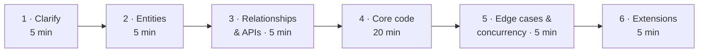

## Know which round you're in

"LLD" is used for three different interviews. Ask your recruiter which one you have, because the preparation is different.

| Round | Typical at | Length | You produce | Graded on |
|---|---|---|---|---|
| **Object-oriented design (OOD)** | Google, Amazon, Meta, Microsoft, Uber (US) | 45–60 min | Class diagram + key classes/methods in code or pseudocode | Modeling, abstractions, trade-off talk |
| **Machine coding** | Flipkart, Swiggy, Uber India, PhonePe, Razorpay, many startups | 90–120 min | A **running** program in your IDE, demoed at the end | Working code, structure, extensibility, edge cases |
| **Concurrency design** | Fintech, trading, infra teams | 60 min | Thread-safe component + reasoning | Races, locking, deadlocks |

This course trains all three at once. Every exercise makes you write **runnable code against hidden tests**, which is machine-coding standard. Every lesson teaches the **reasoning out loud** that OOD rounds score.

> **Interview tip:** If the recruiter says "low-level design" and the company is a US big-tech, assume OOD with real code for the core classes. If they mention "your own IDE" or "90 minutes", it's machine coding. Optimise for something that runs.

## What interviewers actually score

Most companies use a rubric close to this one. The mock interviews in this app score you against the same six criteria.

1. **Requirements & scoping.** Did you ask the right questions and cut scope deliberately?
2. **Entities & relationships.** Are the classes the right ones, with crisp responsibilities?
3. **Patterns & SOLID.** Are there abstractions *exactly where things vary*?
4. **Working, readable code.** Does it compile and run? Would they approve it in a pull request?
5. **Edge cases, errors, concurrency.** Is the system still correct when inputs are bad or two users act at once?
6. **Communication & extensibility.** When they say "now add X", can you point at one class to change?

The biggest single reason for a no-hire is **"didn't finish a working core"**. Candidates rarely fail for lack of patterns. They fail because they spent 35 minutes on a beautiful diagram and never wrote `park(vehicle)`.

## The six-step script

Use the same structure for every problem. Practise it until it's automatic. The times below are for a 45–60 minute OOD round. For a 90-minute machine-coding round, double steps 4–5.



### 1. Clarify (≤ 5 min)

Ask questions that **change the design**, not trivia. A good set for almost any problem:

- **Actors:** who uses it? (customer, admin, system/cron)
- **Core use cases:** the 3–5 things it *must* do. Write them down as a numbered list and get a nod.
- **Scale of the model:** one building or many? one currency? max N?
- **Variations:** which parts are likely to change? (pricing, payment, matching algorithm). This is where your patterns go.
- **Concurrency:** can two users act on the same thing at once? (seat, slot, driver, account)
- **Out of scope:** say it explicitly: "I'll skip auth, persistence and UI. I'll use in-memory repositories."

### 2. Entities (≤ 5 min)

Underline the **nouns** in the requirements. Each candidate noun is one of:

- an **entity** with identity and lifecycle (`Ticket`, `Order`, `Trip`)
- a **value object**: immutable, compared by value (`Money`, `Location`, `TimeSlot`)
- an **enum**: closed set of states/types (`VehicleSize`, `OrderStatus`)
- a **service/manager** that coordinates entities (`ParkingLot`, `BookingService`)
- *not a class at all.* An attribute (`color`) or an actor outside the system.

**Verbs** become methods. Put each method on the class that **owns the data it needs**.

### 3. Relationships & APIs (≤ 5 min)

Sketch a quick class diagram: `has-a` (composition) or `is-a` (inheritance), with multiplicities. Then write the **public API** of the main service as method signatures. This is your contract with the interviewer:

```java
class ParkingLot {
    Ticket park(Vehicle v);              // throws LotFullException
    Receipt unpark(String ticketId);
    int availableSpots(SpotSize size);
}
```

```go
type ParkingLot interface {
    Park(v Vehicle) (*Ticket, error)     // ErrLotFull
    Unpark(ticketID string) (*Receipt, error)
    AvailableSpots(size SpotSize) int
}
```

### 4. Core code (the bulk of the time)

Write code **top-down**: the service's main method first, calling helpers that don't exist yet. Then fill those helpers in. This shows the interviewer the whole flow early, and if you run out of time, the missing pieces are leaf details.

- Build the **happy path end to end first**. Then add validation.
- Use **in-memory maps as repositories**. Never fight with a database.
- Use **enums and small value types** instead of strings and ints.
- **Name things for the domain**: `assignSpot`, not `process`.

### 5. Edge cases & concurrency

Walk through the edge cases out loud: invalid input, not found, full or empty, duplicates, and "two requests at the same time". For the concurrency case, name the **shared mutable state** and how you protect it: a lock per resource, an atomic compare-and-set, or a single goroutine owning the state.

### 6. Extensions

Interviewers almost always end with "now support X". The right answer points to one place: *"`PricingStrategy` is an interface, so I add `WeekendPricing` and inject it. Nothing else changes."* If your answer is "I'd refactor…", your design was missing an abstraction there.

## Talking while you code

Silence is scored as "unclear thinking". Use these phrases:

- *"I'm assuming X; tell me if that's wrong."* (it shows you're scoping)
- *"There are two options here: A is simpler, B is more extensible because… I'll go with A and keep the interface so B is a drop-in."*
- *"This is the part most likely to change, so I'm putting it behind an interface."*
- *"I'll leave a TODO for validation and come back. I want the whole flow working first."*

## Machine-coding specifics

- **Project layout** (even in one file, group by role): `model` (entities, enums), `service` (business logic), `repository` (in-memory storage), `strategy` (pluggable algorithms), `exception`.
- **Have a `main`/driver** that runs the demo scenario from the problem statement. Interviewers often run it themselves.
- **Commit to one language** and know its standard library cold: collections, `Optional`/errors, `ConcurrentHashMap`/`sync.Mutex`, sorting, time.
- **Typing speed matters.** That's why every exercise here is real code in a real editor.

## Your 14 days

| Days | Focus |
|---|---|
| 1 | This playbook, OOP/SOLID from the interview side, UML in 5 minutes |
| 2–4 | The design patterns that actually come up, each with code you write |
| 5 | Concurrency for LLD: locks, queues, double-booking, LRU cache |
| 6–12 | The classic problems, from Parking Lot to Uber, built and tested |
| 13–14 | Timed mock interviews, the follow-up playbook and the final cheat sheet |

Budget **4 hours a day**. Each day's agenda adds up to about that. If you fall behind, cut lessons you already know cold, never the exercises.
