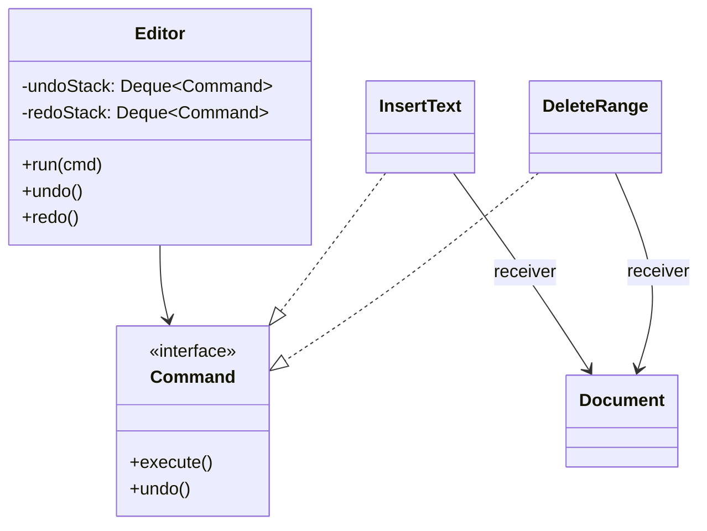

## The idea

Wrap a request in an object with `execute()` (and often `undo()`). The **invoker** (an editor, a remote control, a job queue) runs commands without knowing what they do.



## Undo/redo: the canonical interview use

The rules every interviewer checks:

1. `run(cmd)`: execute, push onto **undo**, **clear redo**. A new action invalidates the redo history.
2. `undo()`: pop from undo, call `cmd.undo()`, push onto **redo**.
3. `redo()`: pop from redo, `cmd.execute()` again, push back onto **undo**.
4. Undo or redo with an empty stack is a no-op (or returns false). It never throws.
5. A command must store **what it needs to reverse itself**. `DeleteRange` has to remember the deleted text.

```java
interface Command { void execute(); void undo(); }

final class DeleteRange implements Command {
    private final Document doc; private final int from, to;
    private String removed;                 // captured on execute, used by undo
    DeleteRange(Document doc, int from, int to) { this.doc = doc; this.from = from; this.to = to; }
    public void execute() { removed = doc.text().substring(from, to); doc.delete(from, to); }
    public void undo() { doc.insert(from, removed); }
}

final class History {
    private final Deque<Command> undo = new ArrayDeque<>(), redo = new ArrayDeque<>();
    void run(Command c) { c.execute(); undo.push(c); redo.clear(); }
    boolean undo() { if (undo.isEmpty()) return false; Command c = undo.pop(); c.undo(); redo.push(c); return true; }
    boolean redo() { if (redo.isEmpty()) return false; Command c = redo.pop(); c.execute(); undo.push(c); return true; }
}
```

```go
type Command interface {
	Execute()
	Undo()
}

type History struct{ undo, redo []Command }

func (h *History) Run(c Command) {
	c.Execute()
	h.undo = append(h.undo, c)
	h.redo = h.redo[:0]
}

func (h *History) Undo() bool {
	if len(h.undo) == 0 {
		return false
	}
	c := h.undo[len(h.undo)-1]
	h.undo = h.undo[:len(h.undo)-1]
	c.Undo()
	h.redo = append(h.redo, c)
	return true
}
```

## Alternatives to mention

- **Memento:** snapshot the whole state instead of reversing each command. Simpler, but uses more memory. Fine for small documents or game boards (undo a chess move by restoring the board).
- **Event sourcing:** commands, recorded as events, *are* the source of truth. Mention it for wallet ledgers and audit trails.

## Other places Command shows up

- **Job queues and schedulers:** a `Task` object with `run()`, retries and backoff
- **Smart-home remote / macro buttons:** a `MacroCommand` is a list of commands (Composite + Command)
- **Transactions in a KV store:** record inverse operations so `ROLLBACK` can undo them (you'll build this on Day 11)
- **Request objects in machine coding:** parse each input line into a command object, then dispatch. This keeps `main` clean
