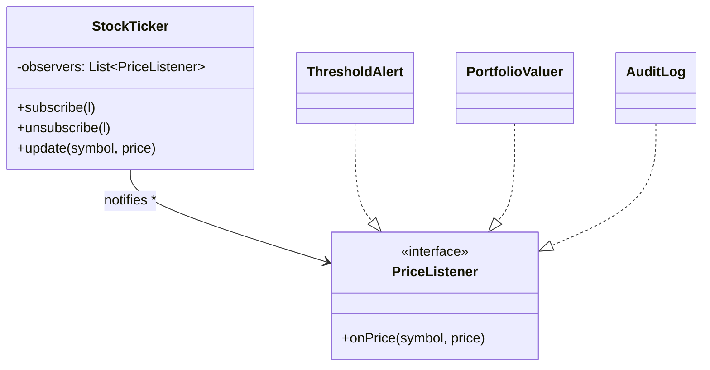

## The idea

A **subject** keeps a list of **observers** and notifies them when something happens. The subject doesn't know what the observers do. It only knows the interface.



## Where it appears

- **Notifications:** order status changed → email, SMS, push, analytics
- **Booking systems:** seat released → notify the wait-list
- **Auctions:** new highest bid → notify the other bidders
- **Elevator:** floor button pressed → controller reacts
- **Pub-sub / event bus:** the same idea with topics and a broker in the middle

## Code shape

```java
interface PriceListener {
    void onPrice(String symbol, long price);
}

final class StockTicker {
    private final Map<String, Long> last = new HashMap<>();
    private final List<PriceListener> listeners = new CopyOnWriteArrayList<>();

    Runnable subscribe(PriceListener l) {          // return an "unsubscribe" handle
        listeners.add(l);
        return () -> listeners.remove(l);
    }

    void update(String symbol, long price) {
        Long prev = last.put(symbol, price);
        if (prev != null && prev == price) return;  // only notify on change
        for (PriceListener l : listeners) {
            try { l.onPrice(symbol, price); }
            catch (RuntimeException e) { /* one bad listener must not break the others */ }
        }
    }
}
```

```go
type PriceListener interface {
	OnPrice(symbol string, price int64)
}

type StockTicker struct {
	mu        sync.Mutex
	last      map[string]int64
	listeners map[int]PriceListener
	nextID    int
}

// Subscribe returns a function that unsubscribes, which is idiomatic and avoids comparing interfaces.
func (t *StockTicker) Subscribe(l PriceListener) (unsubscribe func()) {
	t.mu.Lock()
	defer t.mu.Unlock()
	id := t.nextID
	t.nextID++
	t.listeners[id] = l
	return func() {
		t.mu.Lock()
		defer t.mu.Unlock()
		delete(t.listeners, id)
	}
}
```

## The questions interviewers ask next

| Question | Good answer |
|---|---|
| *What if one observer throws or is slow?* | Isolate failures per observer (try/catch). For slow observers, notify asynchronously through a queue or executor, or a channel per subscriber in Go |
| *Can observers unsubscribe while being notified?* | Iterate over a snapshot: `CopyOnWriteArrayList`, or copy the slice under the lock and notify **outside** the lock |
| *Push or pull?* | Push the data in the event (`onPrice(symbol, price)`) for simple cases. Pass the subject (pull) if observers need different views |
| *Memory leaks?* | Return an unsubscribe handle. Forgotten observers are the classic leak |
| *Ordering guarantees?* | Synchronous in-process notification is in subscription order. With async delivery, say what's guaranteed (per-key order with one worker per key, for example) |
| *How does this become pub-sub?* | Add a broker with topics, decouple producers from consumers, and add persistence or offsets for replay. You'll build one on Day 8 |

> **Interview tip:** never call observers while holding the subject's lock. An observer that calls back into the subject (for example `ticker.update` inside `onPrice`) would deadlock, or re-enter in an inconsistent state. Snapshot the list under the lock, release it, then notify.
