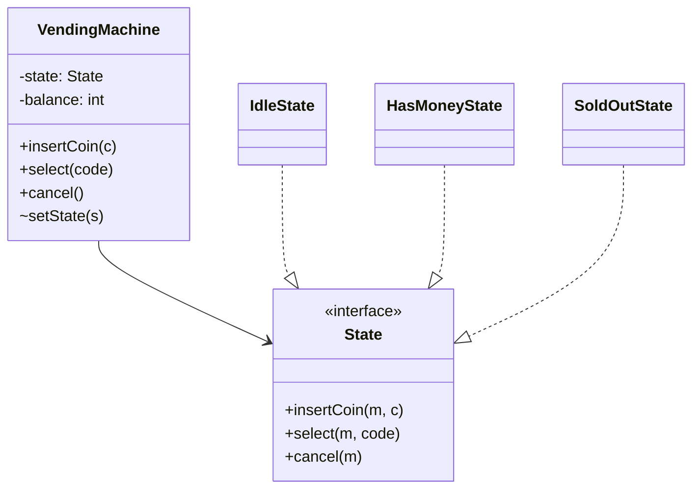

## The smell it fixes

```java
void insertCoin(int c) {
    if (state == IDLE) { ... state = HAS_MONEY; }
    else if (state == HAS_MONEY) { ... }
    else if (state == DISPENSING) { throw ... }
    else if (state == OUT_OF_STOCK) { refund(c); }
}
void selectProduct(String code) { /* the same 4-way if-chain again */ }
void cancel() { /* and again */ }
```

```python
def insert_coin(self, c: int) -> None:
    if self.state == IDLE:
        ...
        self.state = HAS_MONEY
    elif self.state == HAS_MONEY:
        ...
    elif self.state == DISPENSING:
        raise ...
    elif self.state == OUT_OF_STOCK:
        self.refund(c)

def select_product(self, code: str) -> None: ...  # the same 4-way if-chain again
def cancel(self) -> None: ...                     # and again
```

Every operation repeats the same branching on state, and adding a state means editing every method.

## Two good solutions. Know both

### Option A: the State pattern (polymorphic states)

Each state is a class implementing the operations. The context delegates to its current state, and states trigger transitions.



```java
interface State {
    void insertCoin(VendingMachine m, int coin);
    void select(VendingMachine m, String code);
    int cancel(VendingMachine m);
}

final class IdleState implements State {
    public void insertCoin(VendingMachine m, int coin) {
        m.addBalance(coin);
        m.setState(new HasMoneyState());
    }
    public void select(VendingMachine m, String code) { throw new IllegalStateException("insert money first"); }
    public int cancel(VendingMachine m) { return 0; }
}
```

```go
type State interface {
	InsertCoin(m *VendingMachine, coin int) error
	Select(m *VendingMachine, code string) (Product, error)
	Cancel(m *VendingMachine) int
}

type idleState struct{}

func (idleState) InsertCoin(m *VendingMachine, coin int) error {
	m.balance += coin
	m.state = hasMoneyState{}
	return nil
}
func (idleState) Select(*VendingMachine, string) (Product, error) { return Product{}, ErrInsertMoneyFirst }
func (idleState) Cancel(*VendingMachine) int                      { return 0 }
```

```python
class State(ABC):
    @abstractmethod
    def insert_coin(self, m: VendingMachine, coin: int) -> None: ...

    @abstractmethod
    def select(self, m: VendingMachine, code: str) -> Product: ...

    @abstractmethod
    def cancel(self, m: VendingMachine) -> int: ...


class IdleState(State):
    def insert_coin(self, m, coin):
        m.add_balance(coin)
        m.set_state(HasMoneyState())

    def select(self, m, code):
        raise MachineStateError("insert money first")

    def cancel(self, m):
        return 0
```

**Use when** states have substantially different behaviour, or there are many states and operations (vending machine, ATM, a game turn).

### Option B: an enum + a transition table

For lifecycles where operations mostly just **move between states with guards**, as with orders, bookings and trips, a transition map is shorter and just as clear:

```java
enum OrderStatus { CREATED, PAID, SHIPPED, DELIVERED, CANCELLED }

private static final Map<OrderStatus, Set<OrderStatus>> ALLOWED = Map.of(
    CREATED,   Set.of(PAID, CANCELLED),
    PAID,      Set.of(SHIPPED, CANCELLED),
    SHIPPED,   Set.of(DELIVERED),
    DELIVERED, Set.of(),
    CANCELLED, Set.of());

void transition(OrderStatus to) {
    if (!ALLOWED.get(status).contains(to))
        throw new IllegalStateException(status + " -> " + to + " not allowed");
    status = to;
}
```

```go
type Status int

const (
	Created Status = iota
	Paid
	Shipped
	Delivered
	Cancelled
)

var allowed = map[Status][]Status{
	Created: {Paid, Cancelled},
	Paid:    {Shipped, Cancelled},
	Shipped: {Delivered},
}

func (o *Order) transition(to Status) error {
	if !slices.Contains(allowed[o.status], to) {
		return fmt.Errorf("%w: %v -> %v", ErrIllegalTransition, o.status, to)
	}
	o.status = to
	return nil
}
```

```python
class OrderStatus(Enum):
    CREATED = "CREATED"
    PAID = "PAID"
    SHIPPED = "SHIPPED"
    DELIVERED = "DELIVERED"
    CANCELLED = "CANCELLED"


ALLOWED = {
    OrderStatus.CREATED: {OrderStatus.PAID, OrderStatus.CANCELLED},
    OrderStatus.PAID: {OrderStatus.SHIPPED, OrderStatus.CANCELLED},
    OrderStatus.SHIPPED: {OrderStatus.DELIVERED},
}


def transition(self, to: OrderStatus) -> None:
    if to not in ALLOWED.get(self.status, set()):
        raise IllegalTransitionError("%s -> %s not allowed" % (self.status.name, to.name))
    self.status = to
```

**Say:** *"The order lifecycle is mostly guarded transitions, so I'll use an enum with a transition table. If states start having very different behaviour, I'd promote them to State classes."* That shows judgement, which scores higher than reaching for the full pattern every time.

## Checklist for any stateful design

1. **Draw the state diagram first.** It takes 60 seconds and finds the missing transitions.
2. Every operation is either **allowed** (with a defined effect) or **rejected** (with a clear error) in each state. No silent no-ops unless the spec says so.
3. **Side effects on transitions** (refund on cancel, release the seat on expiry) live in one place.
4. **Concurrency:** two operations racing on the same object (cancel vs. ship) must be serialised: `synchronized` on the entity, a per-entity lock, or compare-and-set on the status.
5. **Terminal states** have no outgoing transitions. Test that.
