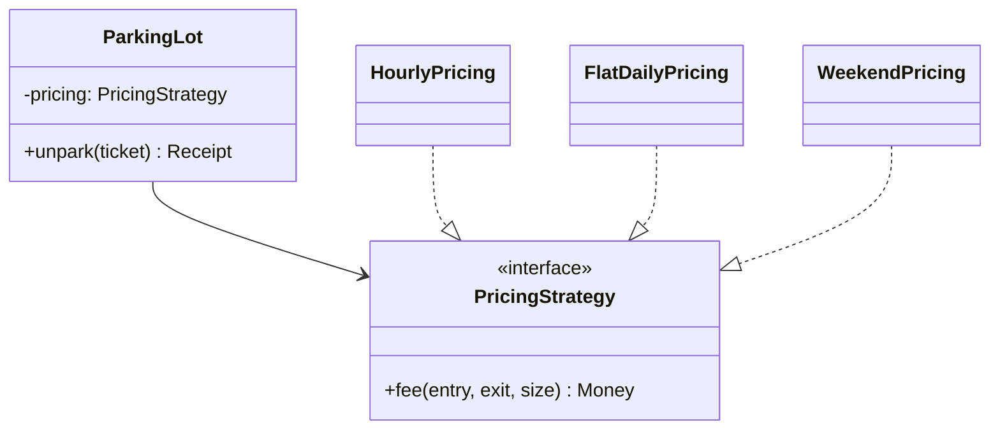

## The idea

Put an **algorithm that varies** behind an interface, and let the context hold a reference to it. The context never branches on *which* algorithm it has.



## Where it appears in classic problems

| Problem | The strategy |
|---|---|
| Parking lot | Pricing (hourly / flat / weekend), spot allocation (nearest / by floor) |
| Splitwise | Split type (equal / exact / percentage) |
| Uber / food delivery | Driver matching (nearest / highest-rated), surge pricing |
| Elevator | Scheduling (FCFS / SCAN / LOOK) |
| Cache | Eviction (LRU / LFU / FIFO) |
| Rate limiter | Algorithm (token bucket / sliding window / fixed window) |
| Snake & ladder / games | Dice (fair / loaded for tests), player move policy |
| E-commerce | Discount rules, payment method, shipping cost |

When the interviewer says *"we might want different X later"*, they're asking for a Strategy.

## Code shape

```java
interface PricingStrategy {
    long fee(Duration parked, SpotSize size);
}

final class HourlyPricing implements PricingStrategy {
    private final Map<SpotSize, Long> ratePerHour;
    HourlyPricing(Map<SpotSize, Long> ratePerHour) { this.ratePerHour = Map.copyOf(ratePerHour); }
    public long fee(Duration parked, SpotSize size) {
        long hours = Math.max(1, (parked.toMinutes() + 59) / 60);   // round up, minimum 1h
        return hours * ratePerHour.get(size);
    }
}

final class ParkingLot {
    private final PricingStrategy pricing;            // injected
    ParkingLot(PricingStrategy pricing) { this.pricing = pricing; }
}
```

```go
type PricingStrategy interface {
	Fee(parked time.Duration, size SpotSize) int64
}

type HourlyPricing struct{ RatePerHour map[SpotSize]int64 }

func (p HourlyPricing) Fee(parked time.Duration, size SpotSize) int64 {
	hours := int64(math.Ceil(parked.Hours()))
	if hours < 1 {
		hours = 1
	}
	return hours * p.RatePerHour[size]
}

// A function type can also be a strategy, like http.HandlerFunc:
type PricingFunc func(time.Duration, SpotSize) int64

func (f PricingFunc) Fee(d time.Duration, s SpotSize) int64 { return f(d, s) }
```

```python
class PricingStrategy(ABC):
    @abstractmethod
    def fee(self, parked: timedelta, size: SpotSize) -> int: ...


class HourlyPricing(PricingStrategy):
    def __init__(self, rate_per_hour: Dict[SpotSize, int]) -> None:
        self._rate_per_hour = dict(rate_per_hour)

    def fee(self, parked: timedelta, size: SpotSize) -> int:
        hours = max(1, math.ceil(parked / timedelta(hours=1)))  # round up, minimum 1h
        return hours * self._rate_per_hour[size]


class ParkingLot:
    def __init__(self, pricing: PricingStrategy) -> None:
        self._pricing = pricing  # injected


# In Python a plain function can be the strategy too: Callable[[timedelta, SpotSize], int]
```

<div class="lang-note" data-lang="java">

**Java tip:** a single-method strategy interface is a functional interface. Tests and simple variants can pass a lambda: `new ParkingLot((d, s) -> 0)`. Mention it, but keep named classes for real strategies so they're discoverable.

</div>

<div class="lang-note" data-lang="python">

**Python tip:** functions are first-class, so a one-method strategy can simply be a callable: `ParkingLot(pricing=lambda parked, size: 0)` in a test. Keep named classes (subclassing an ABC) for real strategies, so they're discoverable and can hold configuration such as rate tables.

</div>

## Strategy vs State vs Template Method

These three get confused in interviews. The distinction:

- **Strategy:** the *client chooses* the algorithm, and it usually stays fixed for the object's lifetime.
- **State:** the object *switches its own* behaviour object as its internal state changes (vending machine: Idle → HasMoney → Dispensing).
- **Template Method:** the *skeleton is fixed in a base class*, and subclasses fill in steps. It uses inheritance where Strategy uses composition.

## Selecting a strategy at runtime

If the strategy depends on the request ("card payments use X, UPI uses Y"), combine it with a **factory/registry**: `Map<PaymentType, PaymentStrategy>`. If several strategies can apply and you pick the best one (like the discounts exercise), the context loops over a list.
