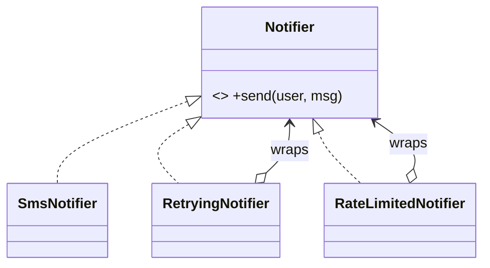

## Decorator: add behaviour by wrapping

**Trigger:** *"add retries / logging / caching / rate limiting / toppings, in any combination"*. A decorator **implements the same interface** as the thing it wraps and adds behaviour before or after delegating.



```java
final class RetryingNotifier implements Notifier {
    private final Notifier inner; private final int attempts;
    RetryingNotifier(Notifier inner, int attempts) { this.inner = inner; this.attempts = attempts; }
    public void send(User u, String msg) {
        RuntimeException last = null;
        for (int i = 0; i < attempts; i++) {
            try { inner.send(u, msg); return; } catch (RuntimeException e) { last = e; }
        }
        throw last;
    }
}
// Composition at wiring time, in any order:
Notifier sms = new RateLimitedNotifier(new RetryingNotifier(new SmsNotifier(gw), 3), clock, Duration.ofHours(1));
```

```go
type retrying struct {
	inner    Notifier
	attempts int
}

func WithRetry(n Notifier, attempts int) Notifier { return &retrying{n, attempts} }

func (r *retrying) Send(u User, msg string) error {
	var err error
	for i := 0; i < r.attempts; i++ {
		if err = r.inner.Send(u, msg); err == nil {
			return nil
		}
	}
	return err
}
// Go's net/http middleware is the decorator pattern: func(http.Handler) http.Handler.
```

**Why not subclass?** `RetryingRateLimitedLoggingSmsNotifier` needs a class per combination. Decorators compose at runtime. Java's `BufferedInputStream(new FileInputStream(...))` is the textbook example to cite.

## Adapter: make an incompatible interface fit

**Trigger:** *"we must integrate a third-party / legacy API whose shape doesn't match ours"*.

```java
interface PaymentGateway { Receipt charge(long cents, String currency); }

// Vendor SDK we can't change: amounts in major units as BigDecimal, different names
final class StripeAdapter implements PaymentGateway {
    private final StripeClient client;
    StripeAdapter(StripeClient client) { this.client = client; }
    public Receipt charge(long cents, String currency) {
        StripeCharge c = client.createCharge(BigDecimal.valueOf(cents, 2), currency.toLowerCase());
        return new Receipt(c.getId(), cents);
    }
}
```

The core domain depends on `PaymentGateway`, and only the adapter knows Stripe exists. Swapping vendors means writing a new adapter.

## Facade: one simple entry point over a subsystem

**Trigger:** *"the client shouldn't have to orchestrate inventory, payment and shipping itself"*.

```java
final class CheckoutFacade {
    private final InventoryService inventory; private final PaymentService payments; private final ShippingService shipping;
    Order placeOrder(Cart cart, PaymentDetails pd, Address to) {
        inventory.reserve(cart);
        try {
            payments.charge(pd, cart.total());
        } catch (PaymentException e) { inventory.release(cart); throw e; }
        return shipping.schedule(cart, to);
    }
}
```

In machine-coding rounds, your top-level service (`ParkingLotService`, `SplitwiseApp`) usually **is** a facade over repositories and strategies. Name it as one.

## Composite: trees where leaves and branches look the same

**Trigger:** file systems, org charts, menus, product bundles, expression trees. Anything with "a group can contain items **or other groups**".

```java
interface Node { String name(); long size(); }
record FileNode(String name, long size) implements Node {}
final class Dir implements Node {
    private final String name; private final Map<String, Node> children = new TreeMap<>();
    Dir(String name) { this.name = name; }
    public String name() { return name; }
    public long size() { return children.values().stream().mapToLong(Node::size).sum(); } // recursion
    void add(Node n) { children.put(n.name(), n); }
}
```

```go
type Node interface {
	Name() string
	Size() int64
}

type File struct {
	name string
	size int64
}

type Dir struct {
	name     string
	children map[string]Node
}

func (d *Dir) Size() int64 {
	var total int64
	for _, c := range d.children {
		total += c.Size()
	}
	return total
}
```

## Proxy: same interface, controlled access

**Trigger:** lazy loading, caching, access control, remote calls. A proxy looks like the real object but **decides whether and when** to call it.

| Proxy kind | Example |
|---|---|
| Virtual (lazy) | `ImageProxy` loads the file only on first `display()` |
| Protection | `AdminOnlyRepository` checks the caller's role before delegating |
| Caching | `CachingWeatherClient` returns the cached value if it's fresh |
| Remote | gRPC/RMI stubs |

**Decorator vs Proxy:** structurally identical. A decorator **adds** behaviour, and you stack several of them. A proxy **controls access** to one real subject. Say that sentence when asked.

## Picker

| You hear… | Reach for |
|---|---|
| "in any combination", "add X on top of" | Decorator |
| "third-party API", "legacy system", "different format" | Adapter |
| "simplify for the client", "one call does everything" | Facade |
| "contains items or other groups", "tree", "nested" | Composite |
| "lazy", "cache in front of", "restrict access" | Proxy |
| Two independent dimensions of variation (shape × renderer) | Bridge (mention only) |
| Millions of tiny similar objects (chess pieces, glyphs) | Flyweight (mention only) |
