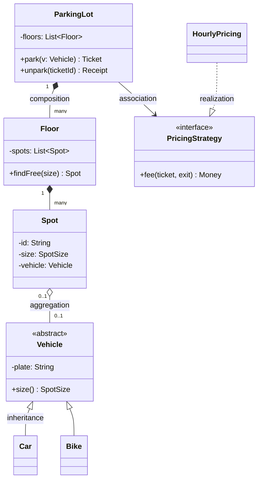
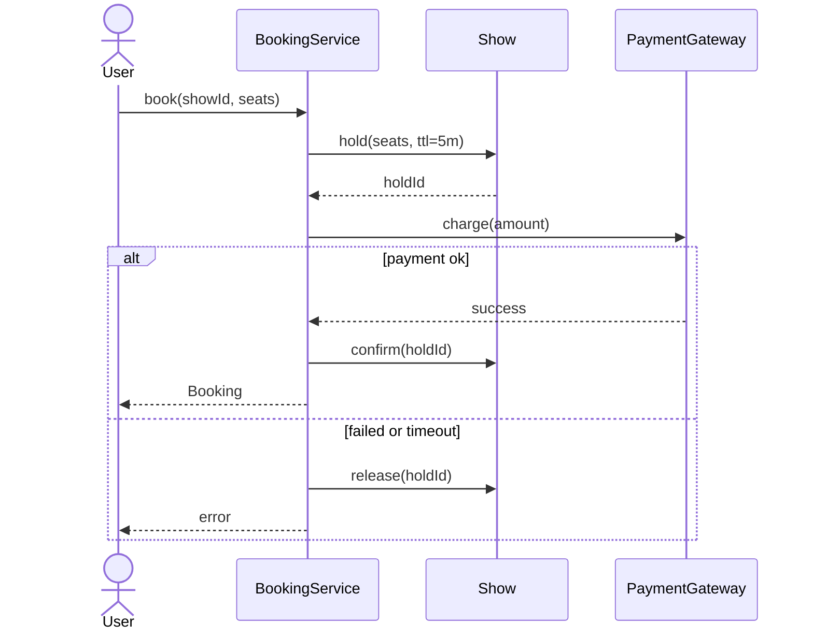
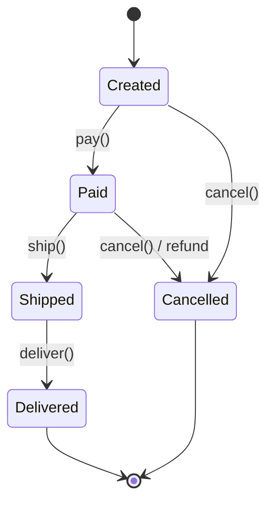

Nobody grades UML syntax. Interviewers grade whether your diagram **communicates the structure quickly**. You need five arrows and one diagram type, two at most.

## The class diagram

A box is a class: name, key fields, key methods. Skip getters, setters and private helpers.

## The five relationships

| Arrow | Name | Meaning | Example |
|---|---|---|---|
| `◆──` (filled diamond) | **Composition** | Owns the part, and the part dies with the whole | Lot ◆── Floor |
| `◇──` (hollow diamond) | **Aggregation** | Has-a, but the part lives independently | Spot ◇── Vehicle |
| `──▷` (hollow triangle) | **Inheritance** | is-a | Car ──▷ Vehicle |
| `- - ▷` (dashed, hollow triangle) | **Realization** | implements an interface | HourlyPricing - - ▷ PricingStrategy |
| `──>` | **Association / uses** | holds a reference or calls | Lot ──> PricingStrategy |

Add **multiplicities** on composition and association lines: `1`, `0..1`, `*`. They raise the questions worth asking: *can a spot hold two bikes? can a ticket exist without a vehicle?*

> **Interview tip:** On a real whiteboard, plain boxes and lines labelled "has many" or "implements" are perfectly fine. Don't burn three minutes drawing diamonds neatly.

## The sequence diagram (when flows matter)

Use one when the **order of calls across objects** is the interesting part: booking with payment, an elevator request, a checkout flow. One diagram for the main use case is plenty.

## A five-minute drawing routine

1. Draw the **central service** box in the middle (`ParkingLot`, `BookingService`).
2. Around it, draw the **entities** it manages, with composition lines and multiplicities.
3. Mark the **interfaces** where behaviour varies (pricing, matching, notifications) with `<<interface>>` and one implementation each.
4. Add **enums** as small boxes on the side (`SpotSize`, `BookingStatus`).
5. Stop. Move on to the API signatures and code.

## State diagrams for lifecycles

If an entity has a lifecycle (Order, Trip, Booking, Elevator), a tiny state diagram is the fastest way to show you've thought about **illegal transitions**. These become the State pattern, or at least a guarded `switch`.

Any arrow that's **not** on the diagram is an error in code: `ship()` on a `Created` order must fail.
