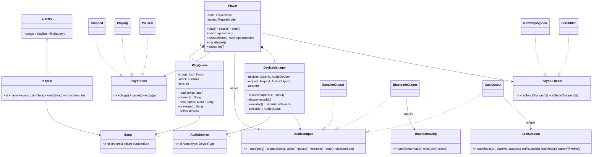

Draw the **class diagram**: catalog on one side, playback on the other. Mark interfaces, composition and multiplicities.

<!-- answer -->

## What to say

- `Player` is the **context** of the State pattern and the **facade** the UI talks to.
- `PlayQueue` is **pure logic** with no audio and no threads, so it is easy to unit-test.
- `AudioOutput` is the **Adapter** target. Every device comes with a vendor SDK that has its own vocabulary (Cast wants a URL and milliseconds, Bluetooth wants raw PCM frames). One adapter per device type translates, so the player only ever speaks `AudioOutput`. Tests use a fake that records calls.
- `DeviceManager` owns the **device list**: devices come and go at runtime, it keeps the active one, and it knows the speaker fallback. The player asks it for an output; it never builds adapters itself.
- Songs are shared, immutable values. Playlists and queues both reference them.
