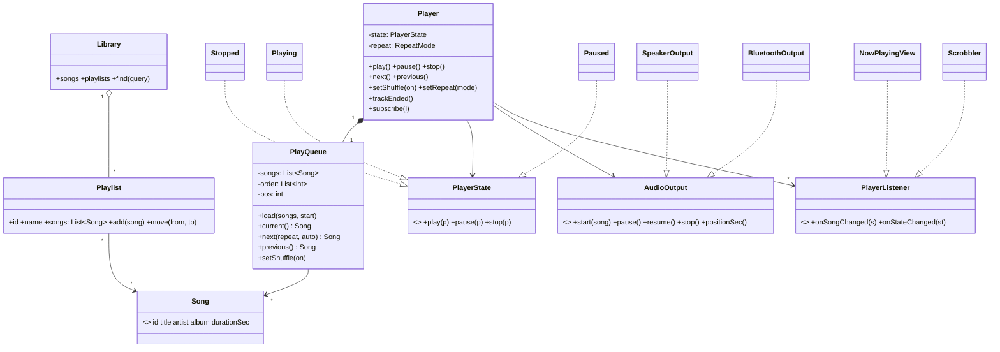

Draw the **class diagram**: catalog on one side, playback on the other. Mark interfaces, composition and multiplicities.

<!-- answer -->

## What to say

- `Player` is the **context** of the State pattern and the **facade** the UI talks to.
- `PlayQueue` is **pure logic** with no audio and no threads, so it is easy to unit-test.
- `AudioOutput` is an **adapter** seam. Real decoders/devices sit behind it, and tests use a fake that records calls.
- Songs are shared, immutable values. Playlists and queues both reference them.
