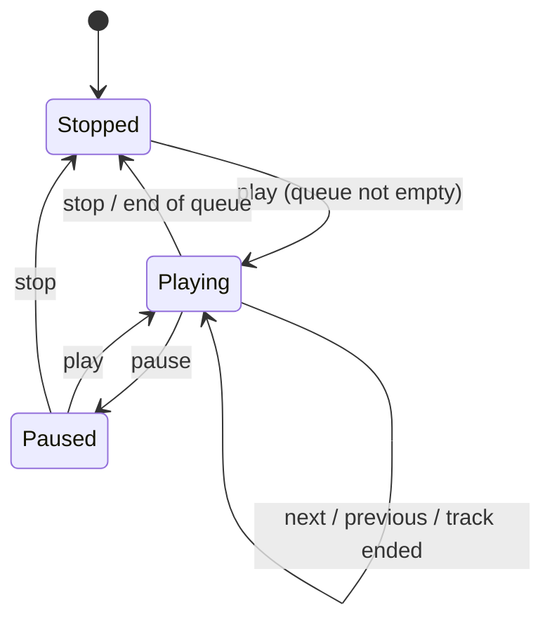

Fill in the **state transition table** for the player: states as rows, actions (`play`, `pause`, `stop`, `next`, `track ended`) as columns. For every cell, write the next state and the side effect.

Then sketch how you'd implement it so that adding a `BUFFERING` state later is easy.

<!-- answer -->

## Transition table

| State \ action | play | pause | stop | next / previous | track ended |
|---|---|---|---|---|---|
| **STOPPED** | start current → PLAYING (no-op if queue empty) | no-op | no-op | move cursor, start song → PLAYING | n/a |
| **PLAYING** | no-op | pause audio → PAUSED | stop audio → STOPPED | start new song → PLAYING (STOPPED at end) | advance by repeat mode → PLAYING / STOPPED |
| **PAUSED** | resume audio → PLAYING | no-op | stop audio → STOPPED | start new song → PLAYING | n/a |

The **no-ops** matter: double-tapping pause must not throw.

## State pattern

Each state is a class. Each action **returns the next state** and performs the side effect. `Player` delegates.

```java
interface PlayerState {
    PlayerState play(Player p);
    PlayerState pause(Player p);
    PlayerState stop(Player p);
}

class Paused implements PlayerState {
    public PlayerState play(Player p)  { p.out.resume(); return PLAYING; }
    public PlayerState pause(Player p) { return this; }               // no-op
    public PlayerState stop(Player p)  { p.out.stop(); return STOPPED; }
}

// in Player
synchronized void pause() { setState(state.pause(this)); }
```

```go
type state interface {
	play(p *Player) state
	pause(p *Player) state
	stop(p *Player) state
}

type paused struct{}

func (paused) play(p *Player) state  { p.out.Resume(); return playing{} }
func (s paused) pause(*Player) state { return s } // no-op
func (paused) stop(p *Player) state  { p.out.Stop(); return stopped{} }
```

```python
class Paused(PlayerState):
    def play(self, p):
        p.out.resume()
        return PLAYING

    def pause(self, p):
        return self  # no-op

    def stop(self, p):
        p.out.stop()
        return STOPPED
```

## Why it's worth it here

- Adding `BUFFERING` (or `AD_PLAYING`) is a **new class** plus one or two transitions into it. You don't have to edit a `switch` in five methods.
- States are stateless, so share **singletons** and don't allocate on every tap.

> **Honest trade-off to mention:** with three states and simple rules, an enum plus a transition table is also fine. Say that the State pattern starts paying off once per-state behaviour grows, for example buffering timeouts or ad rules.


