Draw the **class diagram**. Show the facade, queue and workers, the sender hierarchy, the filter chain, templates and preferences.

```mermaid
classDiagram
  class NotificationService {
    +send(notification) id
    +status(id) List~Delivery~
  }
  class NotificationQueue { <<interface>> +enqueue(n, priority) +poll() +retryLater(d, delay) }
  class Dispatcher {
    -senders: Map~Channel,ChannelSender~
    -filters: List~DeliveryFilter~
    +process(notification)
  }
  class ChannelSender { <<interface>> +send(message) }
  class DeliveryFilter { <<interface>> +check(n, channel, prefs) FilterResult }
  class TemplateStore { +render(templateId, channel, locale, params) Message }
  class PreferenceStore { <<interface>> +get(userId) UserPreferences }
  class RetryPolicy { +maxAttempts +delayBefore(attempt) }
  class DeliveryListener { <<interface>> +onStatus(delivery) }
  class Notification { <<value>> key userId templateId category priority params channels }
  class Delivery { channel status attempts lastError }
  NotificationService --> NotificationQueue
  NotificationService ..> Notification : accepts
  Dispatcher --> NotificationQueue : polls
  Dispatcher --> "*" ChannelSender
  Dispatcher --> "*" DeliveryFilter
  Dispatcher --> TemplateStore
  Dispatcher --> PreferenceStore
  Dispatcher --> RetryPolicy
  Dispatcher --> "*" DeliveryListener
  Notification "1" --> "*" Delivery
  EmailSender ..|> ChannelSender
  SmsSender ..|> ChannelSender
  PushSender ..|> ChannelSender
  InAppSender ..|> ChannelSender
  RetryingSender ..|> ChannelSender
  RetryingSender o-- ChannelSender : wraps
  PreferenceFilter ..|> DeliveryFilter
  QuietHoursFilter ..|> DeliveryFilter
  RateLimitFilter ..|> DeliveryFilter
```

<!-- answer -->

## What to say

- `NotificationService` accepts requests and returns quickly. `Dispatcher` workers do the slow part.
- `Map<Channel, ChannelSender>` is a **registry**, so there's no `switch (channel)` anywhere. A new channel is a new sender plus registration.
- Filters are a **chain**. Each can veto a delivery with a reason (`SKIPPED: quiet hours`), and adding one doesn't touch the others.
- `RetryingSender` is a **decorator**. Retries, failover and metrics wrap any sender.
