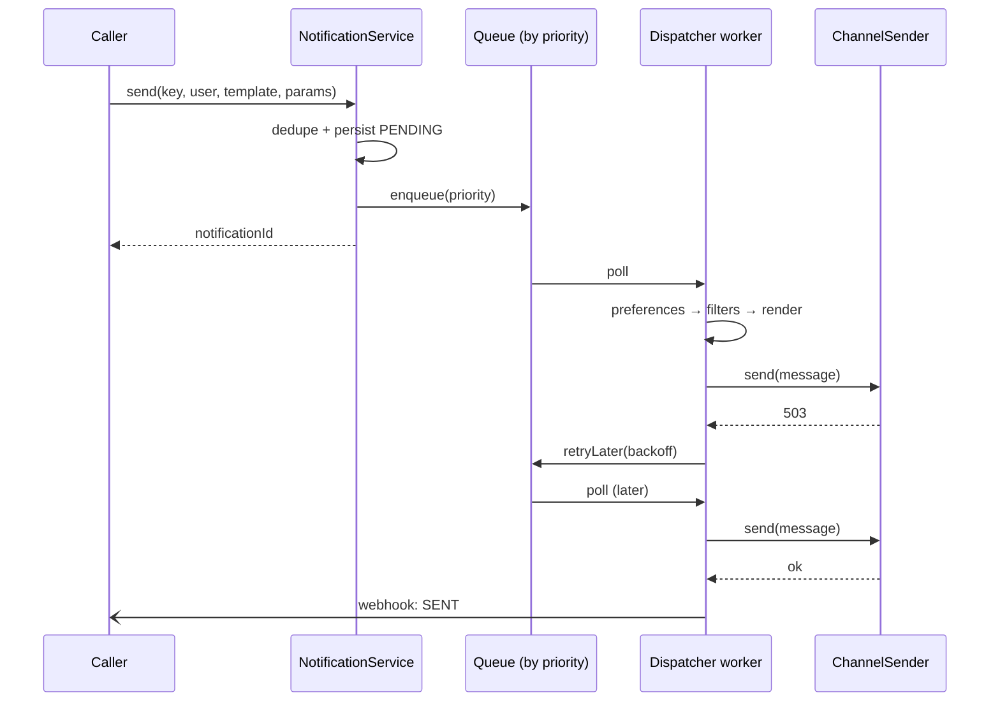

Describe the end-to-end flow for `send(notification)` (numbered steps, or a sequence diagram):

- What does the caller get back, and when?
- In what order do dedupe, preferences, rendering and sending happen, and why?
- What happens on a provider error?
- How do you stop a marketing blast from delaying OTPs?

<!-- answer -->

## Accept (synchronous, fast)

1. Validate the request (template exists, channels known).
2. **Dedupe**: atomically `putIfAbsent(idempotencyKey)`. If it's already present, return the *existing* notification id.
3. Persist the notification with deliveries `PENDING`.
4. **Enqueue** on the queue for its priority, and return the `notificationId` immediately.

## Deliver (asynchronous worker, per channel)

5. Load **preferences** once.
6. Run the **filter chain**: opted out? category muted? quiet hours (delay, unless CRITICAL)? rate limit exceeded? Each veto → `SKIPPED` with a reason (or rescheduled for quiet hours).
7. **Render** the template for this channel and locale. Rendering happens after filtering, so no work is wasted on skipped deliveries.
8. **Send** through `senders[channel]`. Success → `SENT` (store the provider message id).
9. Error:
   - **transient** (timeout, 5xx, 429) → `retryLater` with exponential backoff and jitter, `attempts++`
   - **permanent** (invalid number, unsubscribed token) → `FAILED`, no retry
   - max attempts reached → `FAILED` and the **dead-letter queue**
10. Publish the status change to **listeners** (status store, metrics, caller webhook). Provider delivery receipts later move `SENT → DELIVERED`.

## Priority isolation

Use **separate queues and worker pools per priority** (or a weighted poller). A strict priority queue alone isn't enough, because marketing jobs already in flight hold all the workers. Separate pools mean OTP workers are never busy with marketing.
