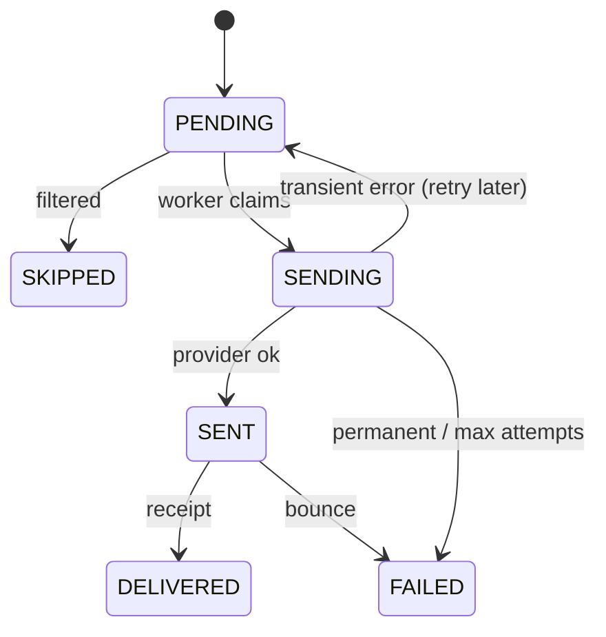

Answer each:

1. The order service calls `send` and times out, so it retries. The first call actually succeeded. How do you avoid sending the SMS twice? Where exactly is the race?
2. Your queue is **at-least-once**: occasionally two workers get the same delivery. What protects the user?
3. Design the retry policy. Which errors are retried? What delays?
4. Where do you rate-limit, and on what key?

<!-- answer -->

## 1. Idempotent accept

- Callers send an **idempotency key** (e.g. `order-42-shipped`). The service does an **atomic** `putIfAbsent(key → notificationId)`: `ConcurrentHashMap.putIfAbsent`, `SETNX` in Redis, or a unique index in the DB.
- **The race:** `if (!store.contains(key)) { store.add(key); enqueue(); }` lets two concurrent retries both pass the check. It has to be a single atomic check-and-mark.
- Return the **existing** id to the duplicate, so the caller sees the same result.
- Expire keys after a window (e.g. 24 h).

## 2. At-least-once workers

- Before sending, move the delivery `PENDING → SENDING` with a **conditional update** (`UPDATE ... WHERE status = 'PENDING'`). Only one worker wins, and the other drops the message.
- Pass a deterministic **provider idempotency key** (e.g. `notificationId:channel`) where the provider supports it, which covers "sent, then crashed before saving SENT".
- Be honest about the guarantee: true exactly-once is impossible end to end. You get at-least-once plus dedupe at each hop.

## 3. Retry policy

| Error | Retry? |
|---|---|
| timeout, 5xx, 429 (throttled) | **yes**, transient |
| invalid phone number, unregistered device token, unsubscribed | **no**, permanent (and clean up the token) |
| template missing | no, it's a bug, so alert |

- **Exponential backoff with jitter**: `delay = base × 2^(attempt-1) ± random`. Jitter avoids synchronised retry storms after a provider outage.
- Max attempts per priority (OTPs: few and fast, because a 10-minute-late OTP is useless; receipts: more and slower).
- Retries are **re-enqueued with a delay**, not done with `sleep` in a worker, so workers stay free.
- After max attempts → **dead-letter queue** plus an alert, with manual replay.

## 4. Rate limiting

- **Per user per category** (e.g. at most 3 marketing pushes a day). This is a filter in the chain, using a sliding window or token bucket keyed by `user:category`.
- **Per provider**: respect each provider's TPS quota with a token bucket in front of the sender (a decorator). On 429, back off.
- **Never rate-limit CRITICAL** (OTPs) per user in the same bucket as marketing.

