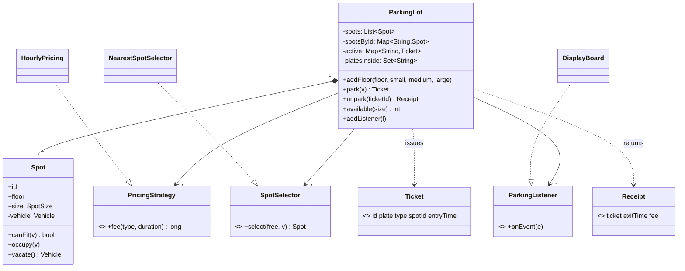

Draw the **class diagram** for your entities. On paper is fine, or write it as Mermaid / PlantUML / plain text in the box.

Show:
- composition versus association
- the interfaces and their implementations
- multiplicities on the main relationships

<!-- answer -->

## What to say while drawing

- **Composition** (`*--`): the lot creates and owns its spots, and a spot never exists outside a lot.
- **Association** to the strategies: the lot *uses* them, and they're injected in the constructor (dependency inversion).
- `Ticket` and `Receipt` are **immutable value objects**. Nothing mutates a ticket after it's issued.
- `ParkingLot` is a **facade**. Gates only ever call `park` and `unpark` and never touch spots directly.
- The extra maps (`spotsById`, `active`, `platesInside`) exist for **O(1) lookups** on unpark and duplicate checks.

> **Common mistake:** a `Gate` class hierarchy (`EntryGate`, `ExitGate`) with nothing in it. Gates are just *callers* of the facade unless the interviewer gives them behaviour.
