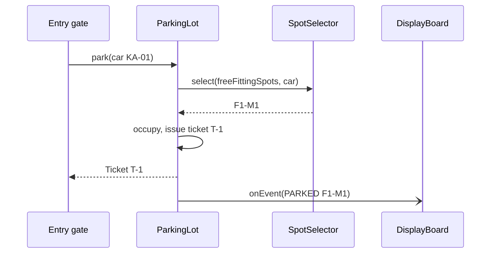

Write the step-by-step logic (pseudocode or bullets) for:

1. `park(vehicle) → Ticket`
2. `unpark(ticketId) → Receipt`

Include every **failure case** and the **data structures** each step reads or writes.

<!-- answer -->

## `park(vehicle)`

```
park(v):
  lock
    if v.plate in platesInside        → error "already parked"
    free = [s in spots where s.isFree() and s.canFit(v)]   // in lot order
    spot = selector.select(free, v)
    if spot == null                   → error "lot full for this type"
    spot.occupy(v)
    ticket = Ticket(nextId(), v.plate, v.type, spot.id, clock.now())
    active[ticket.id] = ticket
    platesInside.add(v.plate)
  unlock
  notify listeners: PARKED(spot)      // outside the lock
  return ticket
```

## `unpark(ticketId)`

```
unpark(id):
  lock
    ticket = active.remove(id)
    if ticket == null                 → error "unknown or already used ticket"
    spot = spotsById[ticket.spotId]
    spot.vacate()
    platesInside.remove(ticket.plate)
    exit = clock.now()
    fee  = pricing.fee(ticket.type, exit - ticket.entryTime)
  unlock
  notify listeners: FREED(spot)
  return Receipt(ticket, exit, fee)
```

## Points interviewers listen for

- **Remove the ticket from `active` as the first step.** A second unpark with the same ticket then fails, so a ticket can't be paid twice.
- The selector gets the **already-filtered free list in "nearest" order**, so the default strategy is `free[0]`. Strategies stay tiny and the lot keeps the invariants.
- `Clock` is **injected**. Tests advance a fake clock by 61 minutes and assert 2 hours were charged, with no `sleep`.
- Lookups are O(1) through the maps. Selection is O(spots), which is fine. Mention a per-size free list or heap if the lot is huge.


