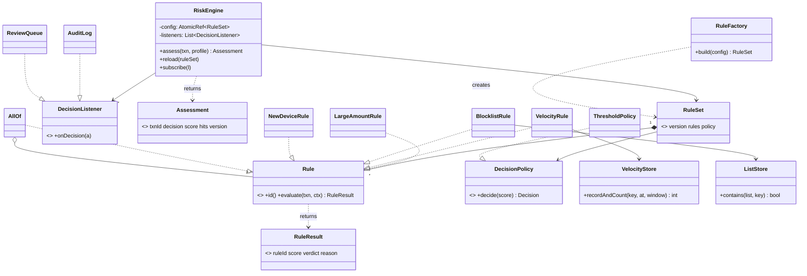

Draw the **class diagram**. Show the engine, the rule hierarchy, the policy, the stores, config loading and the listeners.

<!-- answer -->

## What to say

- **`RuleSet` is an immutable snapshot**: rules, policy and a version. A reload builds a new one and swaps the reference, and in-flight assessments keep the one they started with.
- `AllOf` / `AnyOf` are **composite** rules (Specification pattern), so analysts can express *"new device AND amount > 50k"* in config.
- `Assessment` records the **config version**, so any past decision can be explained and reproduced.
- Listeners decouple **side effects** (audit, review cases, alerts) from the decision itself.
