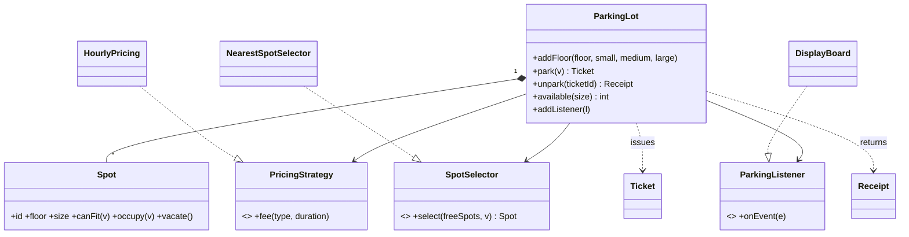

**Design a parking lot** is the single most common LLD question. In this build-along you'll write the whole thing, step by step, and the tests for each step must pass before the next one unlocks. The tests accumulate, so step 4 also re-runs steps 1–3.

## Requirements (what you'd agree with the interviewer)

1. The lot has several **floors**. Each floor has **small**, **medium** and **large** spots.
2. Vehicles are **bike**, **car** or **truck**:
   - bike → any spot · car → medium or large · truck → large only
3. `park(vehicle)` assigns a spot and issues a **ticket**. Fail if no spot fits, or if the plate is already parked.
4. `unpark(ticketId)` frees the spot and returns a **receipt** with the fee.
5. **Pricing** is per vehicle type, per started hour, minimum one hour, and must be swappable.
6. **Spot selection** must be swappable. The default is "nearest": the lowest floor, then the smallest fitting size.
7. A **display board** shows free spots per size, live.
8. Many entry gates operate **concurrently**.

Out of scope: payments, reservations, persistence, UI.

## The design you're building

Types that are given to you in the starter: `VehicleType`, `SpotSize`, `Vehicle`, `Ticket`, `Receipt`, `Event`, the clock, and the three interfaces (abstract base classes in Python). You implement `Spot`, `HourlyPricing`, `NearestSpotSelector`, `ParkingLot` and `DisplayBoard`.

> **Interview tip:** notice how little inheritance there is. Vehicle types are an **enum**, and the fitting rule is data. Many candidates write `class Car extends Vehicle` and `class Truck extends Vehicle`, then struggle when asked about electric cars. Polymorphism is used where **behaviour varies**: pricing, selection and listeners.
