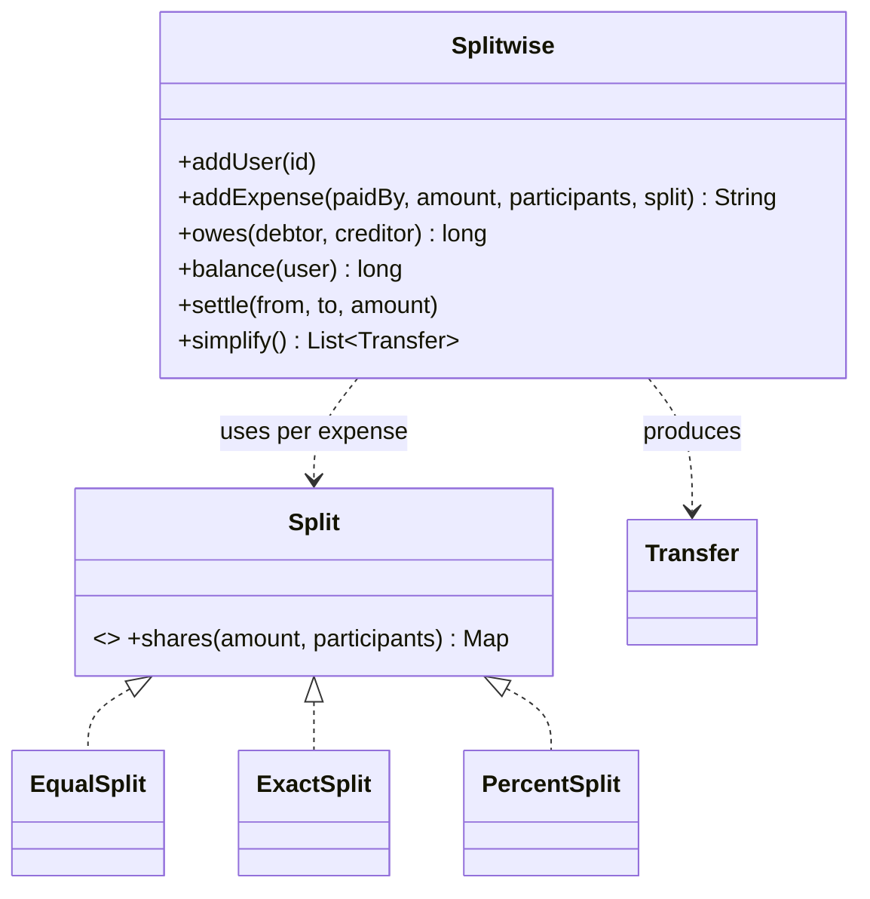

**Design Splitwise** is asked at Flipkart, Atlassian, Uber, Amazon and PhonePe. It looks easy, but it tests **Strategy**, **money handling**, **data-structure choice** and an **algorithm** (debt simplification) all at once. Read the *Money, Ledgers & Idempotency* lesson first.

## Requirements

1. Users can be added. Ids are unique.
2. An expense has a payer, an amount (integer minor units), participants, and a **split type**:
   - **EQUAL:** divided equally, with remainder units going to the first participants
   - **EXACT:** explicit amounts that must sum to the total
   - **PERCENT:** percentages that must sum to 100. Floor each share, then hand out the leftover units in participant order
3. Show how much one user owes another (**netted**: if A owes B 30 and B owes A 10, then A owes B 20).
4. Show a user's net balance (positive means others owe them).
5. Record a settlement payment.
6. **Simplify debts:** produce a short list of transfers that settles everyone.

## Design

**The key data-structure choice:** store a pairwise **net** map `net[a][b]` = amount `a` owes `b`, kept antisymmetric (`net[b][a] == -net[a][b]`). Every expense and settlement becomes a few `addDebt(a, b, x)` calls. `owes` and `balance` are simple reads.
